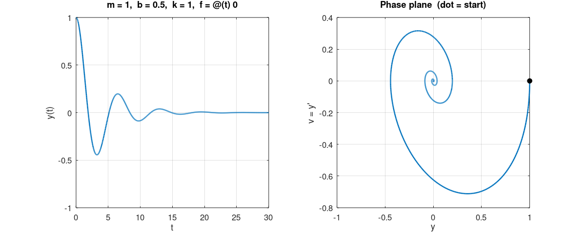
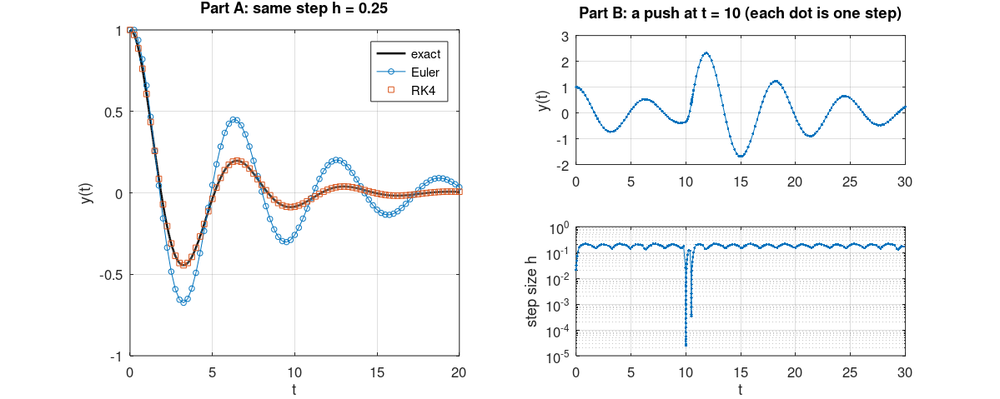
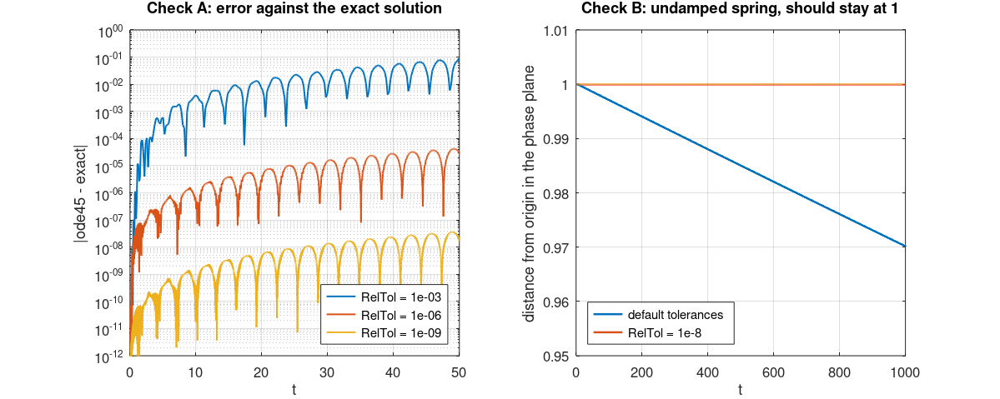
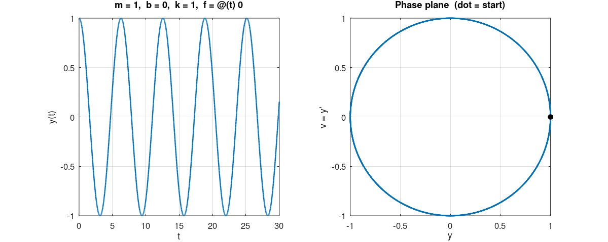
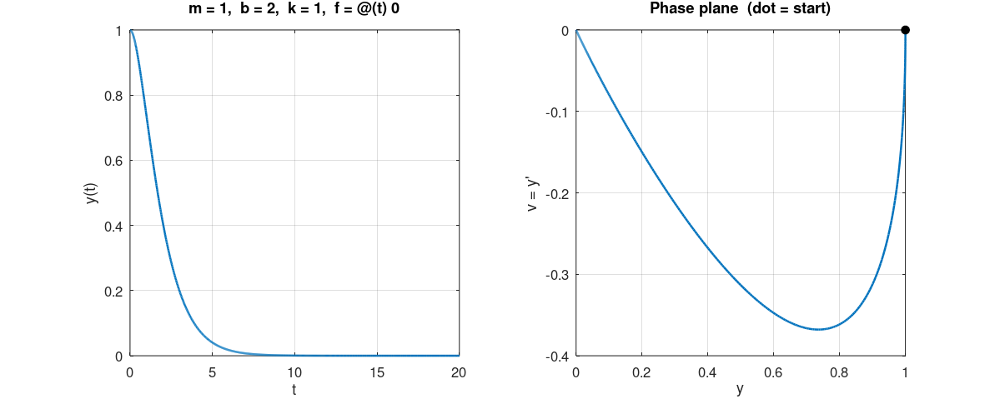
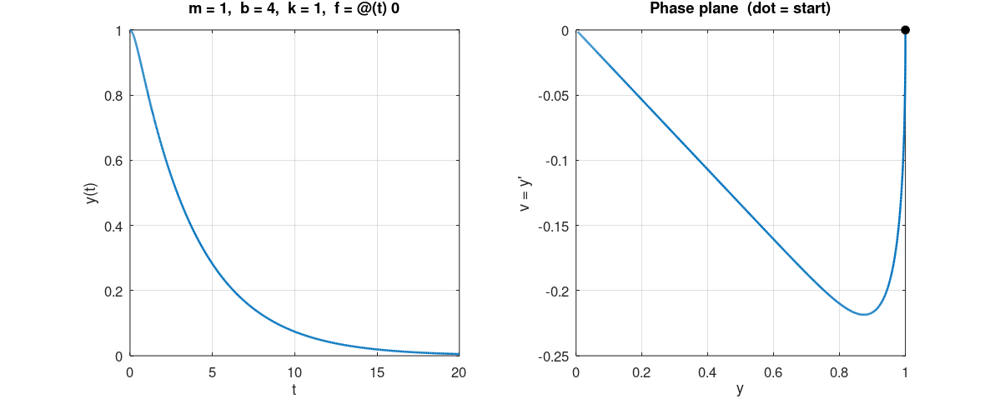
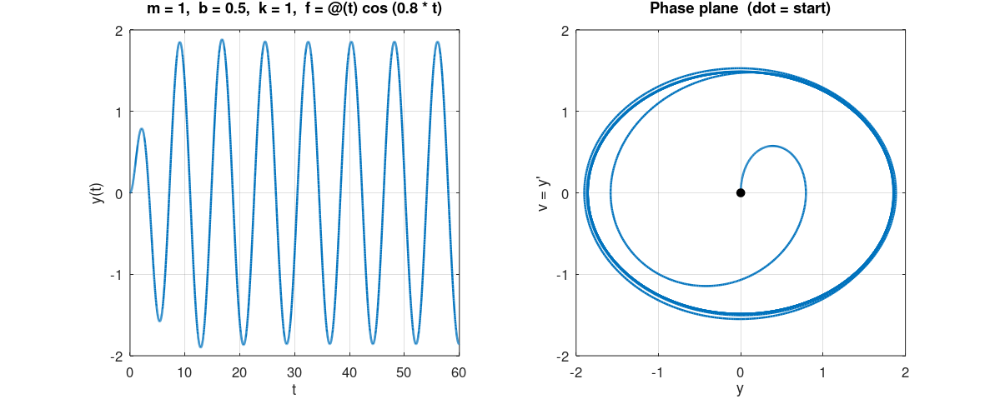
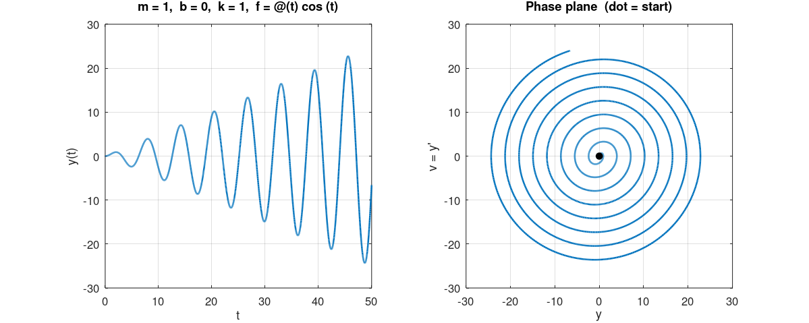
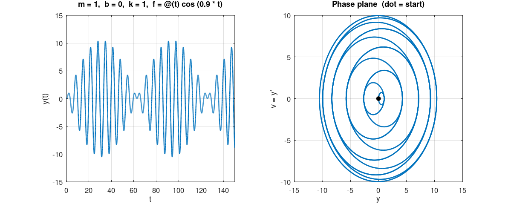
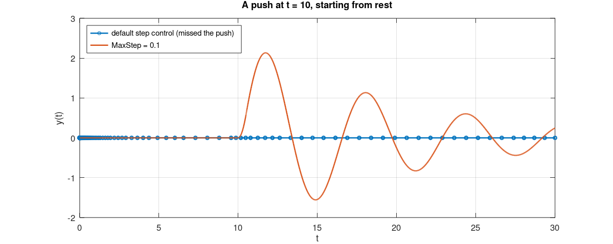

# Solving a Mass-Spring IVP Numerically

> Also on the web, with nicer formatting: [Solving IVPs Numerically](https://scottastrong.org/Teaching/Educational+Tutorials/Differential+Equations/IVP+Mass-Spring/Solving+IVPs+Numerically).
> Code for this page is in the folders next to it: [`matlab/`](matlab/), [`python/`](python/), [`r/`](r/), [`mathematica/`](mathematica/).


This page gets you from the equation


```math
m\,y''+b\,y'+k\,y=f(t),\qquad y(t_0)=y_0,\quad y'(t_0)=v_0
```


to a plot of its solution, using MATLAB's built-in solver `ode45`. You will not write any code. You will open one script, change a few numbers at the top, and press Run. The rest of the page explains what the script and the solver are doing, how to check that an answer can be trusted, and what each standard case should look like so you can compare your output against a reference.

You need MATLAB (any recent version; `ode45` is built in and needs no toolbox) and the four scripts collected under [Full codes](#full-codes) at the bottom of this page. Save each one as a `.m` file with the name shown, all in the same folder. The scripts also come as ready-made files next to this page, one folder per language: `matlab/`, `python/`, `r/`, and `mathematica/`.

**Working in Python, R, or Mathematica instead?** Every script on this page also comes in those three languages, as `.py`, `.R`, and `.wl` files with the same names. Each MATLAB box below is followed by its Python, R, and Mathematica versions, and the prose still applies with the substitutions in the table below. The page is written around MATLAB, so read `ode45` as "your language's solver".

<details>
<summary><b>The same solver in four languages</b></summary>

| | MATLAB | Python | R | Mathematica |
|---|---|---|---|---|
| setup | none | `pip install numpy scipy matplotlib` | `install.packages("deSolve")` | none |
| adaptive 4/5 solver | `ode45` | `solve_ivp(..., method="RK45")` | `ode(..., method = "ode45")` | `NDSolve` with `Method -> {"ExplicitRungeKutta", "DifferenceOrder" -> 5}` |
| relative tolerance | `RelTol` | `rtol` | `rtol` | `PrecisionGoal -> 8` means $`10^{-8}`$ |
| absolute tolerance | `AbsTol` | `atol` | `atol` | `AccuracyGoal -> 10` means $`10^{-10}`$ |
| cap on the step size | `MaxStep` | `max_step` | `hmax` | `MaxStepSize` |
| default tolerances | $`10^{-3}`$, $`10^{-6}`$ | $`10^{-3}`$, $`10^{-6}`$ | $`10^{-6}`$, $`10^{-6}`$ | about 8 digits |
| position, velocity in the state | `Y(1)`, `Y(2)` | `Y[0]`, `Y[1]` | `Y[1]`, `Y[2]` | `{yy, vv}` |

Three things differ from MATLAB in ways that matter.
- **Python counts from 0**, so position is `Y[0]` and velocity is `Y[1]`.
- **R's `ode` reports the solution only at the times you list**, and by default it will not step farther than the gap between two listed times. With a fine output grid that quietly makes the steps tiny, so the R scripts set `hmax` explicitly.
- **Mathematica reads formulas.** If `NDSolve` can see the formula for $`f`$, it finds the corners of an on/off push by itself. The scripts define `f[t_?NumericQ] := ...` so that, like `ode45`, it can only sample $`f`$.

Run the Python scripts with `python simulateSpring.py`, the R scripts with `source("simulateSpring.R")` in RStudio, and the Mathematica scripts by opening the `.wl` file and choosing Evaluation > Evaluate Notebook. Each one also saves its figure as a `.png` next to the script.

</details>

<details>
<summary><b>What you will have at the end</b></summary>

- `simulateSpring.m` solves and plots any mass-spring problem you describe in its first section.
- `checkSolver.m` shows two checks for deciding whether a numerical answer is right.
- `underTheHood.m` shows how a time stepper works and where `ode45` puts its steps.
- `missedPush.m` shows the most common way a solver can quietly give a wrong answer, and the fix.

The Python (`.py`), R (`.R`), and Mathematica (`.wl`) versions use the same names and do the same things.

</details>

# The idea

## What "solving numerically" means

For the cases you met in a differential equations course, $`y(t)`$ comes out as a formula. Once the forcing, the coefficients, or the model get more realistic, that stops being possible. A numerical solver gives you something different. It gives you a list of times $`t_0\lt t_1\lt t_2\lt \dots`$ and, at each one, an approximate position $`y_n\approx y(t_n)`$ and velocity $`v_n\approx y'(t_n)`$. Plotting that list is plotting the solution.

The solver builds the list one step at a time. It knows the state now, it can compute how fast the state is changing, and it uses that to move a short time $`h`$ forward. Then it repeats.

## Rewrite the equation as a first-order system

Solvers only take one kind of input, a first-order system $`\vec Y\,'=\vec F(t,\vec Y)`$. A second-order equation is turned into one by giving the velocity its own name,


```math
v=y'.
```


Then $`y''=v'`$, and solving the original equation for $`y''`$ gives


```math
\begin{aligned}
y' &= v,\\
v' &= \frac{f(t)-b\,v-k\,y}{m}.
\end{aligned}
```


Stack the two unknowns into a **state vector** $`\vec Y=\begin{bmatrix}y\\ v\end{bmatrix}`$. The system says how fast each entry of the state changes, given the time and the current state,


```math
\vec Y\,'=\vec F(t,\vec Y)=\begin{bmatrix} v\\[2pt] \dfrac{f(t)-b\,v-k\,y}{m}\end{bmatrix},\qquad \vec Y(t_0)=\begin{bmatrix}y_0\\ v_0\end{bmatrix}.
```


That is all a solver needs. Two initial conditions become one initial state, and one second-order equation becomes two first-order equations. Any $`n`$th-order equation can be handled the same way by carrying $`y,\,y',\,\dots,\,y^{(n-1)}`$ in the state.

# The script, piece by piece

`simulateSpring.m` has five numbered sections. Only Section 1 is meant to be edited. The full listing is under [Full codes](#full-codes).

## Section 1. The problem data

<details>
<summary><b>MATLAB - Section 1, problem data (edit these)</b></summary>

*Every number that defines the problem lives here. Change these and nothing else.*
```matlab
m  = 1;           % mass
b  = 0.5;         % damping coefficient
k  = 1;           % spring constant
f  = @(t) 0;      % external forcing f(t); @(t) 0 means no forcing

y0 = 1;           % initial position  y(t0)
v0 = 0;           % initial velocity  y'(t0)
tspan = [0 30];   % [start time, end time]
```

</details>

<details>
<summary><b>Python - Section 1, problem data (edit these)</b></summary>

```python
m = 1.0            # mass
b = 0.5            # damping coefficient
k = 1.0            # spring constant
f = lambda t: 0.0  # external forcing f(t); lambda t: 0.0 means no forcing

y0 = 1.0           # initial position  y(t0)
v0 = 0.0           # initial velocity  y'(t0)
tspan = (0, 30)    # (start time, end time)
```

</details>

<details>
<summary><b>R - Section 1, problem data (edit these)</b></summary>

```r
m  <- 1                     # mass
b  <- 0.5                   # damping coefficient
k  <- 1                     # spring constant
f  <- function(t) 0         # external forcing f(t); function(t) 0 means no forcing

y0 <- 1                     # initial position  y(t0)
v0 <- 0                     # initial velocity  y'(t0)
tspan <- c(0, 30)           # c(start time, end time)
```

</details>

<details>
<summary><b>Mathematica - Section 1, problem data (edit these)</b></summary>

*The `?NumericQ` makes `NDSolve` treat $`f`$ as a black box it can only sample, the way `ode45` does.*
```mathematica
m  = 1.;            (* mass *)
b  = 0.5;           (* damping coefficient *)
k  = 1.;            (* spring constant *)
f[t_?NumericQ] := 0.;  (* external forcing f(t); 0. means no forcing *)

y0 = 1.;            (* initial position  y(t0) *)
v0 = 0.;            (* initial velocity  y'(t0) *)
tspan = {0., 30.};  (* {start time, end time} *)
```

</details>

The forcing is written as an **anonymous function**, MATLAB's way of writing a short formula in $`t`$. The `@(t)` says "a function of $`t`$," and the expression after it is the formula. Some forcings you might want are below.

| Forcing | How to write it |
|---|---|
| none | `f = @(t) 0;` |
| constant push of size 2 | `f = @(t) 2;` |
| $`F_0\cos(\omega t)`$ with $`F_0=3`$, $`\omega=0.8`$ | `f = @(t) 3*cos(0.8*t);` |
| push of size 5 between $`t=10`$ and $`t=10.5`$ | `f = @(t) 5*(t >= 10 & t <= 10.5);` |
| decaying kick $`e^{-t}\sin(2t)`$ | `f = @(t) exp(-t).*sin(2*t);` |

<details>
<summary><b>The same forcings in Python, R, and Mathematica</b></summary>

| Forcing | Python | R | Mathematica |
|---|---|---|---|
| none | `lambda t: 0.0` | `function(t) 0` | `f[t_?NumericQ] := 0.` |
| constant 2 | `lambda t: 2.0` | `function(t) 2` | `f[t_?NumericQ] := 2.` |
| $`3\cos(0.8t)`$ | `lambda t: 3*np.cos(0.8*t)` | `function(t) 3*cos(0.8*t)` | `f[t_?NumericQ] := 3 Cos[0.8 t]` |
| push of 5 on $`[10,10.5]`$ | `lambda t: 5.0*(10 <= t <= 10.5)` | `function(t) 5*(t >= 10 & t <= 10.5)` | `f[t_?NumericQ] := If[10 <= t <= 10.5, 5., 0.]` |
| $`e^{-t}\sin(2t)`$ | `lambda t: np.exp(-t)*np.sin(2*t)` | `function(t) exp(-t)*sin(2*t)` | `f[t_?NumericQ] := Exp[-t] Sin[2 t]` |

</details>

The comparison `(t >= 10 & t <= 10.5)` is $`1`$ when true and $`0`$ when false, which is how an on/off forcing is written in one line. If you use a forcing with a short burst like this, read [When things go wrong](#when-things-go-wrong) first.

## Section 2. The first-order system

<details>
<summary><b>MATLAB - Section 2, the right-hand side F(t, Y)</b></summary>

*This is the system from [Rewrite the equation as a first-order system](#rewrite-the-equation-as-a-first-order-system), typed in. `Y(1)` is $`y`$ and `Y(2)` is $`v`$.*
```matlab
rhs = @(t, Y) [ Y(2);
                ( f(t) - b*Y(2) - k*Y(1) ) / m ];
```

</details>

<details>
<summary><b>Python - Section 2, the right-hand side F(t, Y)</b></summary>

*`Y[0]` is $`y`$ and `Y[1]` is $`v`$. The solver accepts a list or an array.*
```python
def rhs(t, Y):
    return [Y[1],
            (f(t) - b * Y[1] - k * Y[0]) / m]
```

</details>

<details>
<summary><b>R - Section 2, the right-hand side F(t, Y)</b></summary>

*`Y[1]` is $`y`$ and `Y[2]` is $`v`$. deSolve wants the result wrapped in a `list`, and passes a third argument, `parms`, which we do not use.*
```r
rhs <- function(t, Y, parms) {
  list(c(Y[2],
         (f(t) - b * Y[2] - k * Y[1]) / m))
}
```

</details>

<details>
<summary><b>Mathematica - Section 2, the right-hand side F(t, Y)</b></summary>

*The pattern `{yy_, vv_}` names the two entries of the state, $`y`$ and $`v`$.*
```mathematica
rhs[t_, {yy_, vv_}] := {vv, (f[t] - b vv - k yy)/m};
```

</details>

`rhs` is a function of two inputs, the time `t` and the state `Y`, and it returns a column of two numbers, $`y'`$ and $`v'`$. The semicolon inside the brackets stacks the two entries vertically, and `ode45` requires the result to be a column. Because `m`, `b`, `k`, and `f` already exist when this line runs, `rhs` remembers their values.

## Section 3. Solver settings

<details>
<summary><b>MATLAB - Section 3, tolerances</b></summary>

*How much error `ode45` is allowed to commit on each step.*
```matlab
opts = odeset('RelTol', 1e-8, 'AbsTol', 1e-10);
```

</details>

<details>
<summary><b>Python - Section 3, tolerances</b></summary>

```python
opts = dict(method="RK45", rtol=1e-8, atol=1e-10)
```

</details>

<details>
<summary><b>R - Section 3, tolerances</b></summary>

*`hmax` lets a single step be as long as the whole interval. Without it, R would cap the step at the spacing of the output times.*
```r
rtol <- 1e-8;  atol <- 1e-10;  hmax <- diff(tspan)
```

</details>

<details>
<summary><b>Mathematica - Section 3, tolerances</b></summary>

*`PrecisionGoal -> 8` is `RelTol = 1e-8` and `AccuracyGoal -> 10` is `AbsTol = 1e-10`.*
```mathematica
opts = {Method -> {"ExplicitRungeKutta", "DifferenceOrder" -> 5},
        PrecisionGoal -> 8, AccuracyGoal -> 10};
```

</details>

`RelTol` is the allowed error relative to the size of the solution, so `1e-8` asks for roughly eight correct digits. `AbsTol` is a floor that matters when the solution is near zero, where "relative to the size" stops meaning anything. If you leave the options out, MATLAB uses `RelTol = 1e-3` and `AbsTol = 1e-6`. Those defaults are loose, and [Can you trust the answer](#can-you-trust-the-answer) shows what they can do over a long run. For a two-equation system, tight tolerances cost a fraction of a second, so the script sets them tight.

## Section 4. Solve

<details>
<summary><b>MATLAB - Section 4, the call to <code>ode45</code></b></summary>

*Hand over the system, the time interval, the initial state as a column, and the settings.*
```matlab
[t, Y] = ode45(rhs, tspan, [y0; v0], opts);
y = Y(:, 1);      % position at each output time
v = Y(:, 2);      % velocity at each output time
```

</details>

<details>
<summary><b>Python - Section 4, the call to <code>solve_ivp</code></b></summary>

*`sol.y` has one row per state variable, the transpose of MATLAB's `Y`. Without `t_eval`, `sol.t` is exactly the list of steps taken.*
```python
t_eval = np.linspace(tspan[0], tspan[1], 1501)
sol = solve_ivp(rhs, tspan, [y0, v0], t_eval=t_eval, **opts)
t = sol.t
y = sol.y[0]       # position at each output time
v = sol.y[1]       # velocity at each output time
```

</details>

<details>
<summary><b>R - Section 4, the call to <code>ode</code></b></summary>

*R always reports at the `times` you list. The solver still chooses its own steps in between.*
```r
times <- seq(tspan[1], tspan[2], length.out = 1501)
out <- ode(y = c(y = y0, v = v0), times = times, func = rhs, parms = NULL,
           method = "ode45", rtol = rtol, atol = atol, hmax = hmax)
t <- out[, "time"]
y <- out[, "y"]             # position at each output time
v <- out[, "v"]             # velocity at each output time
```

</details>

<details>
<summary><b>Mathematica - Section 4, the call to <code>NDSolve</code></b></summary>

*`NDSolve` returns a function you can evaluate at any time. `Ysol["Grid"]` lists the times it actually stepped to.*
```mathematica
Ysol = Y /. First@NDSolve[
   {Y'[t] == rhs[t, Y[t]], Y[tspan[[1]]] == {y0, v0}},
   Y, {t, tspan[[1]], tspan[[2]]}, Sequence @@ opts];
y[t_?NumericQ] := Ysol[t][[1]];   (* position at time t *)
v[t_?NumericQ] := Ysol[t][[2]];   (* velocity at time t *)
```

</details>

`ode45` returns two things. `t` is a column of times. `Y` has one row per time and one column per state variable, so `Y(:,1)` is the position and `Y(:,2)` is the velocity.

Two things about `t` surprise people. The times are **not evenly spaced**, because `ode45` chooses its own step sizes (see [Adaptive steps, which is what ode45 adds](#adaptive-steps-which-is-what-ode45-adds)). And the number of output times is **not** the number of steps taken, because MATLAB fills in a few extra points inside each step so plots look smooth. If you want the solution at particular times, give `tspan` as a list instead of two endpoints, for example `tspan = linspace(0, 30, 301);` for every $`0.1`$. The solver still picks its own steps and then reports the solution at the times you asked for.

## Section 5. Plot

<details>
<summary><b>MATLAB - Section 5, position and phase plane</b></summary>

*Left panel is $`y(t)`$. Right panel is $`v`$ against $`y`$, with a dot at the starting state.*
```matlab
figure('Position', [100 100 1000 400]);

subplot(1, 2, 1);
plot(t, y, 'LineWidth', 1.5);
grid on; xlim([tspan(1) tspan(end)]);
xlabel('t'); ylabel('y(t)');
title(sprintf('m = %g,  b = %g,  k = %g,  f = %s', m, b, k, func2str(f)));

subplot(1, 2, 2);
plot(y, v, 'LineWidth', 1.5); hold on;
plot(y(1), v(1), 'ko', 'MarkerFaceColor', 'k');   % starting point
hold off; grid on;
xlabel('y'); ylabel('v = y''');
title('Phase plane  (dot = start)');
```

</details>

<details>
<summary><b>Python - Section 5, position and phase plane</b></summary>

```python
fig, (ax1, ax2) = plt.subplots(1, 2, figsize=(10, 4))

ax1.plot(t, y, lw=1.5)
ax1.grid(True); ax1.set_xlim(tspan)
ax1.set_xlabel("t"); ax1.set_ylabel("y(t)")
ax1.set_title(f"m = {m:g},  b = {b:g},  k = {k:g}")

ax2.plot(y, v, lw=1.5)
ax2.plot(y[0], v[0], "ko")                 # starting point
ax2.grid(True)
ax2.set_xlabel("y"); ax2.set_ylabel("v = y'")
ax2.set_title("Phase plane  (dot = start)")
plt.show()
```

</details>

<details>
<summary><b>R - Section 5, position and phase plane</b></summary>

```r
par(mfrow = c(1, 2))
plot(t, y, type = "l", lwd = 2, col = "blue", xlim = tspan,
     xlab = "t", ylab = "y(t)", main = sprintf("m = %g,  b = %g,  k = %g", m, b, k))
grid()
plot(y, v, type = "l", lwd = 2, col = "blue",
     xlab = "y", ylab = "v = y'", main = "Phase plane  (dot = start)")
points(y[1], v[1], pch = 19)           # starting point
grid()
```

</details>

<details>
<summary><b>Mathematica - Section 5, position and phase plane</b></summary>

```mathematica
GraphicsRow[{
  Plot[y[t], {t, tspan[[1]], tspan[[2]]}, PlotRange -> All,
    GridLines -> Automatic, Frame -> True, FrameLabel -> {"t", "y(t)"}],
  Show[
    ParametricPlot[{y[t], v[t]}, {t, tspan[[1]], tspan[[2]]}, PlotRange -> All,
      AspectRatio -> 1/GoldenRatio, Frame -> True, FrameLabel -> {"y", "v = y'"}],
    Graphics[{Black, PointSize[0.03], Point[{y0, v0}]}]]   (* starting point *)
  }, ImageSize -> 1000]
```

</details>

The **phase plane** plots the state itself, velocity against position, with time left implicit. It shows the type of motion at a glance. A closed loop means the motion repeats forever, an inward spiral means oscillation that dies out, and a curve that falls straight into the origin means the mass returns to rest without swinging.

## What you should see

With the values in Section 1 as given ($`m=1`$, $`b=0.5`$, $`k=1`$, no forcing, released from $`y=1`$ at rest), pressing Run prints

```text
ode45 returned 1345 output times on [0, 30].
Final state: y = -0.000495616, v = 0.000398894
```

and draws



The final state should match to at least four digits. The number of output times may differ between MATLAB versions, and it does not matter. All figures on this page were made by running these exact scripts in GNU Octave, which runs the same MATLAB code, so your fonts, colors, and the way the forcing is printed in the title will look slightly different. The curves and the printed numbers are what to compare.

In Python, R, and Mathematica the first printed line reports a count of steps or slope evaluations instead of output times, and that number differs from MATLAB's. The final state agrees with the MATLAB value above to at least five digits in all three.

# Under the hood

You do not need this section to use the script. It explains what happens between pressing Run and getting the list of times and states, which is what you need to read a solver's warnings and to trust its output.

## A time stepper

Every method here does the same thing. Start from the known state $`\vec Y_n`$ at time $`t_n`$, use $`\vec F`$ to estimate how the state changes over a short time $`h`$, and land on $`\vec Y_{n+1}`$ at $`t_{n+1}=t_n+h`$.

The simplest choice is **Euler's method**. Compute the slope at the start of the step and follow it in a straight line,


```math
\vec Y_{n+1}=\vec Y_n+h\,\vec F(t_n,\vec Y_n).
```


This is the definition of the derivative read backwards. Its weakness is that the slope changes during the step and Euler ignores that. The error made over a whole run shrinks only in proportion to $`h`$, so halving the step only halves the error.

## Better slopes with RK4

The classical **fourth-order Runge-Kutta method (RK4)** samples the slope four times across the step and takes a weighted average.


```math
\begin{aligned}
\vec k_1 &= \vec F(t_n,\ \vec Y_n)\\
\vec k_2 &= \vec F\!\left(t_n+\tfrac h2,\ \vec Y_n+\tfrac h2\vec k_1\right)\\
\vec k_3 &= \vec F\!\left(t_n+\tfrac h2,\ \vec Y_n+\tfrac h2\vec k_2\right)\\
\vec k_4 &= \vec F\!\left(t_n+h,\ \vec Y_n+h\,\vec k_3\right)\\[4pt]
\vec Y_{n+1} &= \vec Y_n+\frac h6\left(\vec k_1+2\vec k_2+2\vec k_3+\vec k_4\right)
\end{aligned}
```


The first slope is Euler's. The second and third look at the midpoint of the step, and the fourth looks at the end. The weights $`1,2,2,1`$ are chosen so that the step agrees with the exact solution's Taylor series through the $`h^4`$ term. Over a whole run the error shrinks like $`h^4`$, so halving the step cuts the error by about $`16`$.

<details>
<summary><b>MATLAB - one Euler step and one RK4 step (reading only)</b></summary>

*Euler, one slope.*
```matlab
YE(:,n+1) = YE(:,n) + h * rhs(t(n), YE(:,n));
```
*RK4, four slopes and their weighted average.*
```matlab
k1 = rhs(t(n),       YR(:,n));
k2 = rhs(t(n) + h/2, YR(:,n) + h/2*k1);
k3 = rhs(t(n) + h/2, YR(:,n) + h/2*k2);
k4 = rhs(t(n) + h,   YR(:,n) + h*k3);
YR(:,n+1) = YR(:,n) + h/6 * (k1 + 2*k2 + 2*k3 + k4);
```

</details>

<details>
<summary><b>Python - one Euler step and one RK4 step (reading only)</b></summary>

```python
YE[:, n + 1] = YE[:, n] + h * rhs(t[n], YE[:, n])

k1 = rhs(t[n],         YR[:, n])
k2 = rhs(t[n] + h / 2, YR[:, n] + h / 2 * k1)
k3 = rhs(t[n] + h / 2, YR[:, n] + h / 2 * k2)
k4 = rhs(t[n] + h,     YR[:, n] + h * k3)
YR[:, n + 1] = YR[:, n] + h / 6 * (k1 + 2 * k2 + 2 * k3 + k4)
```

</details>

<details>
<summary><b>R - one Euler step and one RK4 step (reading only)</b></summary>

```r
YE[, n + 1] <- YE[, n] + h * rhs(t[n], YE[, n])

k1 <- rhs(t[n],         YR[, n])
k2 <- rhs(t[n] + h / 2, YR[, n] + h / 2 * k1)
k3 <- rhs(t[n] + h / 2, YR[, n] + h / 2 * k2)
k4 <- rhs(t[n] + h,     YR[, n] + h * k3)
YR[, n + 1] <- YR[, n] + h / 6 * (k1 + 2 * k2 + 2 * k3 + k4)
```

</details>

<details>
<summary><b>Mathematica - one Euler step and one RK4 step (reading only)</b></summary>

```mathematica
YE[[n + 1]] = YE[[n]] + h rhs[tt[[n]], YE[[n]]];

k1 = rhs[tt[[n]],       YR[[n]]];
k2 = rhs[tt[[n]] + h/2, YR[[n]] + h/2 k1];
k3 = rhs[tt[[n]] + h/2, YR[[n]] + h/2 k2];
k4 = rhs[tt[[n]] + h,   YR[[n]] + h k3];
YR[[n + 1]] = YR[[n]] + h/6 (k1 + 2 k2 + 2 k3 + k4);
```

</details>

The left panel below is Part A of `underTheHood.m`. Both methods take the same $`80`$ steps of size $`h=0.25`$ on the underdamped spring.

```text
Part A, step h = 0.25 (80 steps)
   Euler max error: 2.58e-01
   RK4   max error: 5.21e-05
```



Euler's oscillation dies out far too slowly and drifts out of phase. RK4 sits on the exact curve, about $`5000`$ times more accurate, for four times the work per step.

## Adaptive steps, which is what ode45 adds

A fixed step has to be small enough for the hardest part of the run, which wastes effort everywhere else, and you have to guess it in advance. `ode45` picks the step for you as it goes.

On every step it computes **two** estimates of $`\vec Y_{n+1}`$ from the same set of slope samples, one accurate to fourth order and one to fifth order. (The method is the Dormand-Prince pair, a close relative of RK4 that uses six new slope samples per step.) The two estimates agree closely when the step is small enough and disagree when it is not, so their difference $`\vec e`$ is a free estimate of the error just committed. The step is accepted only if every component passes


```math
|e_i|\le\max\big(\texttt{RelTol}\cdot|y_i|,\ \texttt{AbsTol}\big).
```


If it fails, the step is thrown away and retried with a smaller $`h`$. If it passes easily, the next step is allowed to be larger. The number in `ode45` refers to this 4/5 pair.

The right panels above are Part B of `underTheHood.m`. A lightly damped spring is released from $`y=1`$ and then pushed with $`f=5`$ for $`10\le t\le10.5`$. Each dot is one step `ode45` actually took. During the smooth ringing the steps stay near $`0.2`$. Where the push switches on and off, the forcing jumps, and the steps drop by four orders of magnitude to get through the corner, then grow back right away.

```text
Part B: 208 steps, smallest 2.45e-05, largest 2.17e-01
```

Part A prints the same numbers in every language. Part B's step counts differ (Python 170, R 140, Mathematica 157), because each solver has its own rules for choosing the next step. All four show the same picture: long steps through the smooth ringing and a dive of three to four orders of magnitude at the corners of the push.

# Can you trust the answer

A solver always returns numbers, whether or not they are right. Two checks tell you whether they are, and neither one needs new code. `checkSolver.m` runs both.

**Check A. Compare against a case with a known exact answer.** Before trusting the solver on a problem you cannot solve by hand, run it on one you can. The resonance problem $`y''+y=\cos t`$ with $`y(0)=y'(0)=0`$ has exact solution $`y=\tfrac t2\sin t`$. The left panel shows the error over time for three tolerances.

```text
Check A: resonance, compared with y = (t/2) sin t
   RelTol     output times    max |error|
     1e-03          325         8.48e-02
     1e-06         1173         4.20e-05
     1e-09         4721         3.61e-08
```



The error tracks the tolerance. Each factor of $`1000`$ in `RelTol` buys about three more correct digits, at the cost of roughly four times as many output times.

**Check B. Tighten the tolerance and see whether the answer moves.** This is the check you can always do, even when no exact answer exists. Run the problem, then run it again with `RelTol` and `AbsTol` both $`100`$ times smaller. If the curves you care about do not visibly change, the first answer was good enough. If they do change, keep tightening until they stop.

The right panel shows why this matters. An undamped spring $`y''+y=0`$ released from $`y=1`$ should circle the origin of the phase plane at distance $`1`$ forever. With MATLAB's default tolerances it loses about $`3\%`$ of its amplitude by $`t=1000`$, which looks exactly like a small amount of damping that is not in the equation. With tight tolerances it stays at $`1`$ to six digits.

```text
Check B: undamped spring on [0, 1000], distance from origin at the end
   default tolerances: 0.9701   (should be 1)
   tight tolerances:   0.99999938
```

Your MATLAB numbers for the default run may differ a little from $`0.9701`$. The point is that they are visibly not $`1`$.

<details>
<summary><b>What <code>checkSolver</code> prints in Python, R, and Mathematica</b></summary>

Check A has the same shape everywhere: each factor of $`1000`$ in the tolerance buys about three digits. The counts below are steps actually taken, not output times.

| RelTol | Python steps, error | R steps, error | Mathematica steps, error |
|---|---|---|---|
| $`10^{-3}`$ | 56, $`1.8\times10^{-1}`$ | 81, $`1.7\times10^{-2}`$ | 55, $`6.9\times10^{-2}`$ |
| $`10^{-6}`$ | 246, $`8.1\times10^{-5}`$ | 314, $`1.5\times10^{-5}`$ | 186, $`6.5\times10^{-6}`$ |
| $`10^{-9}`$ | 1012, $`7.2\times10^{-8}`$ | 1240, $`1.5\times10^{-8}`$ | 750, $`3.4\times10^{-9}`$ |

Check B with MATLAB's loose default tolerances ends at $`0.9896`$ in Python, $`1.0128`$ in R, and $`0.9592`$ in Mathematica. R's solver drifts *outward*, which would look like energy being added. Losing or gaining amplitude, the lesson is the same: a loose tolerance can change the physics. With tight tolerances all three stay at $`1`$ to at least six digits.

</details>

# Reference cases

Each case below uses $`m=1`$ and $`k=1`$, so the natural frequency is $`\omega_0=\sqrt{k/m}=1`$ and the period of free oscillation is $`2\pi`$. Damping divides into regimes at $`b=2\sqrt{mk}=2`$. Set Section 1 of `simulateSpring.m` to the values in a row, press Run, and compare your printed final state and your figure to the ones here.

| Case | $`b`$ | `f` | $`y_0`$ | $`v_0`$ | `tspan` | Final $`y`$ | Final $`v`$ |
|---|---|---|---|---|---|---|---|
| Undamped | `0` | `@(t) 0` | `1` | `0` | `[0 30]` | $`0.1543`$ | $`0.9880`$ |
| Underdamped | `0.5` | `@(t) 0` | `1` | `0` | `[0 30]` | $`-4.956\times10^{-4}`$ | $`3.989\times10^{-4}`$ |
| Critically damped | `2` | `@(t) 0` | `1` | `0` | `[0 20]` | $`4.329\times10^{-8}`$ | $`-4.123\times10^{-8}`$ |
| Overdamped | `4` | `@(t) 0` | `1` | `0` | `[0 20]` | $`5.070\times10^{-3}`$ | $`-1.358\times10^{-3}`$ |
| Driven, damped | `0.5` | `@(t) cos(0.8*t)` | `0` | `0` | `[0 60]` | $`-1.857`$ | $`0.05667`$ |
| Resonance | `0` | `@(t) cos(t)` | `0` | `0` | `[0 50]` | $`-6.559`$ | $`23.99`$ |
| Beating | `0` | `@(t) cos(0.9*t)` | `0` | `0` | `[0 150]` | $`-8.923`$ | $`-4.181`$ |

Where an exact solution is easy to write down, the table values agree with it. For example, the undamped case is $`y=\cos t`$, so $`y(30)=\cos 30=0.1543`$, and the resonance case is $`y=\tfrac t2\sin t`$, so $`y(50)=25\sin 50=-6.559`$.

## Undamped, $`b=0`$



The solution is $`y=\cos t`$. With no damping the energy is conserved, so the phase plane is a closed circle traced clockwise over and over.

## Underdamped, $`0\lt b\lt 2`$


The mass still oscillates, but each swing is smaller than the last. The amplitude decays like $`e^{-bt/(2m)}`$ and the phase plane spirals into the origin.

## Critically damped, $`b=2`$



The fastest return to rest without overshooting. The solution is $`y=(1+t)e^{-t}`$. In the phase plane the curve drops straight into the origin without circling it.

## Overdamped, $`b\gt 2`$



Again no oscillation, but the return is slower than critical damping because the heavy damping resists the motion. Compare the two $`y(t)`$ panels. At $`t=10`$ the critically damped mass is essentially at rest while the overdamped one is still visibly creeping in.

## Driven and damped, $`f=\cos(0.8t)`$



Starting from rest, the response is a **transient** that dies out plus a **steady-state** oscillation at the driving frequency $`0.8`$ that does not. After about $`t=20`$ only the steady state is left, with amplitude


```math
\frac{1}{\sqrt{(k-m\omega^2)^2+(b\,\omega)^2}}=\frac{1}{\sqrt{0.36^2+0.4^2}}\approx1.858.
```


In the phase plane the spiral settles onto a closed loop, the steady-state orbit.

## Resonance, $`b=0`$ and $`f=\cos t`$



Driving an undamped spring exactly at its natural frequency adds energy on every swing. The exact solution is $`y=\tfrac t2\sin t`$, so the amplitude grows linearly without bound and the phase plane spirals outward.

## Beating, $`b=0`$ and $`f=\cos(0.9t)`$



Driving close to, but not at, the natural frequency. The exact solution is


```math
y=\frac{\cos(0.9t)-\cos t}{1-0.81}=\frac{2}{0.19}\,\sin(0.95t)\,\sin(0.05t),
```


a fast oscillation inside a slow envelope. The amplitude swells to about $`10.5`$ and dies back to zero every $`\pi/0.05\approx62.8`$ time units. The phase plane fills in a disk instead of tracing one curve.

# When things go wrong

## A short forcing gets skipped

This is the one failure that gives no warning. Start a spring at rest and push it with $`f=5`$ for $`10\le t\le10.5`$. Before $`t=10`$ the solution is exactly zero, so `ode45`'s error estimate is zero and it grows its step as large as it is allowed. By default that limit is a tenth of the whole interval, here $`3`$. A step of size $`3`$ can begin before $`t=10`$ and end after $`t=10.5`$ without ever sampling $`f`$ inside the push, and the solver reports that nothing happened.

```text
No MaxStep:      largest |y| = 0.0000
MaxStep = 0.1:   largest |y| = 2.1341
```



The fix is to cap the step below the width of the shortest feature in the forcing, with the `MaxStep` option.

<details>
<summary><b>MATLAB - capping the step size</b></summary>

*Add `MaxStep` to the options in Section 3. Here the push lasts $`0.5`$, so $`0.1`$ is safe.*
```matlab
opts = odeset('RelTol', 1e-8, 'AbsTol', 1e-10, 'MaxStep', 0.1);
```

</details>

<details>
<summary><b>Python - capping the step size</b></summary>

*SciPy's default `max_step` is infinity, so nothing limits the step unless you set it.*
```python
opts = dict(method="RK45", rtol=1e-8, atol=1e-10, max_step=0.1)
```

</details>

<details>
<summary><b>R - capping the step size</b></summary>

```r
rtol <- 1e-8;  atol <- 1e-10;  hmax <- 0.1
```

</details>

<details>
<summary><b>Mathematica - capping the step size</b></summary>

```mathematica
opts = {Method -> {"ExplicitRungeKutta", "DifferenceOrder" -> 5},
        PrecisionGoal -> 8, AccuracyGoal -> 10, MaxStepSize -> 0.1};
```

</details>

Whether MATLAB's `ode45` actually skips this particular push depends on its exact step sequence, so you may or may not reproduce the flat line. The risk is real either way, and `MaxStep` costs very little. Any time `f` switches on and off, set `MaxStep` smaller than the shortest on or off period.

In the other languages the cap is `max_step=0.1` (Python), `hmax = 0.1` (R), and `MaxStepSize -> 0.1` (Mathematica). Python and R both miss the push with no cap and print $`0.0000`$, then $`2.1337`$ and $`2.1335`$ with it. Mathematica grows its steps more cautiously and happens to catch the push even without a cap ($`2.1279`$, against $`2.1341`$ with it). That was luck, and a shorter or later push could still be skipped.

## Other things to look for

- **An error saying the function must return a column vector**, or a similar message about sizes. The right-hand side is returning a row. Check that the two entries inside the brackets in Section 2 are separated by a semicolon, and that the initial state is written `[y0; v0]`.
- **An error inside `f`.** The forcing must be a function of `t` alone, written `@(t) ...`. A forcing written as a number, `f = 2`, will fail because Section 2 calls it as `f(t)`.
- **The answer changes when you change the tolerance.** The solution is not converged. Keep tightening until it stops changing (Check B).
- **`ode45` runs for a very long time on a simple-looking problem.** This usually means the problem is **stiff**, meaning it has two time scales that are very far apart. For example, $`m=10^{-4}`$, $`b=1`$, $`k=1`$ has one motion that dies out in about $`10^{-4}`$ time units and another that takes about one. The solution after the first instant is a slow, smooth decay, yet `ode45` needs tens of thousands of tiny steps to stay stable. MATLAB's `ode15s` is built for stiff problems and takes the same inputs, so replace `ode45` with `ode15s` in Section 4. For ordinary values of $`m`$, $`b`$, and $`k`$ this does not come up. The stiff solvers elsewhere are `method="LSODA"` or `"Radau"` in Python, `method = "lsoda"` in R (the deSolve default), and Mathematica's default `NDSolve` with the `Method` option removed, which switches to a stiff method by itself.
- **The plot looks wrong but there is no error.** Check the physics before the numerics. Is the sign of the damping right? Is the forcing divided by $`m`$? (It is, in Section 2.) Is `tspan` long enough to see what you are looking for?

# Full codes

Save each listing as a `.m` file with the name in its title, all in the same folder. Run a script by opening it and pressing Run, or by typing its name at the command prompt. The Python, R, and Mathematica listings follow the MATLAB ones. Save them as `.py`, `.R`, and `.wl` files with the same names. All twelve were run, and the numbers quoted on this page are what they print.

<details>
<summary><b>MATLAB - <code>simulateSpring.m</code> (the simulator; edit Section 1 only)</b></summary>

```matlab
%% simulateSpring.m
% Approximately solves the mass-spring initial value problem
%
%     m y'' + b y' + k y = f(t),     y(t0) = y0,   y'(t0) = v0
%
% with MATLAB's built-in adaptive solver ode45. Edit the values in
% Section 1, then press Run. Nothing below Section 1 needs to change.

clear; close all;

%% 1. Problem data (edit these)
m  = 1;           % mass
b  = 0.5;         % damping coefficient
k  = 1;           % spring constant
f  = @(t) 0;      % external forcing f(t); @(t) 0 means no forcing

y0 = 1;           % initial position  y(t0)
v0 = 0;           % initial velocity  y'(t0)
tspan = [0 30];   % [start time, end time]

%% 2. Rewrite as a first-order system
% The state is Y = [y; v] with v = y'. Then
%     y' = v
%     v' = ( f(t) - b*v - k*y ) / m
% Y(1) is position and Y(2) is velocity.
rhs = @(t, Y) [ Y(2);
                ( f(t) - b*Y(2) - k*Y(1) ) / m ];

%% 3. Solver settings
% RelTol and AbsTol set how much error ode45 allows in each step.
% (MATLAB's defaults are RelTol = 1e-3 and AbsTol = 1e-6, which are loose.)
opts = odeset('RelTol', 1e-8, 'AbsTol', 1e-10);

%% 4. Solve
[t, Y] = ode45(rhs, tspan, [y0; v0], opts);
y = Y(:, 1);      % position at each output time
v = Y(:, 2);      % velocity at each output time

fprintf('ode45 returned %d output times on [%g, %g].\n', numel(t), tspan(1), tspan(end));
fprintf('Final state: y = %.6g, v = %.6g\n', y(end), v(end));

%% 5. Plot
figure('Position', [100 100 1000 400]);

subplot(1, 2, 1);
plot(t, y, 'LineWidth', 1.5);
grid on; xlim([tspan(1) tspan(end)]);
xlabel('t'); ylabel('y(t)');
title(sprintf('m = %g,  b = %g,  k = %g,  f = %s', m, b, k, func2str(f)));

subplot(1, 2, 2);
plot(y, v, 'LineWidth', 1.5); hold on;
plot(y(1), v(1), 'ko', 'MarkerFaceColor', 'k');   % starting point
hold off; grid on;
xlabel('y'); ylabel('v = y''');
title('Phase plane  (dot = start)');
```

</details>

<details>
<summary><b>Python - <code>simulateSpring.py</code> (the simulator; edit Section 1 only) (run-verified)</b></summary>

```python
"""simulateSpring.py
Approximately solves the mass-spring initial value problem

    m y'' + b y' + k y = f(t),     y(t0) = y0,   y'(t0) = v0

with SciPy's built-in adaptive solver solve_ivp (method "RK45", the same
Dormand-Prince 4/5 pair as MATLAB's ode45). Edit the values in Section 1,
then run. Nothing below Section 1 needs to change.

Python port of simulateSpring.m.  Needs numpy, scipy, matplotlib.
"""

import numpy as np
import matplotlib.pyplot as plt
from scipy.integrate import solve_ivp

# %% 1. Problem data (edit these)
m = 1.0            # mass
b = 0.5            # damping coefficient
k = 1.0            # spring constant
f = lambda t: 0.0  # external forcing f(t); lambda t: 0.0 means no forcing

y0 = 1.0           # initial position  y(t0)
v0 = 0.0           # initial velocity  y'(t0)
tspan = (0, 30)    # (start time, end time)

# %% 2. Rewrite as a first-order system
# The state is Y = [y, v] with v = y'. Then
#     y' = v
#     v' = ( f(t) - b*v - k*y ) / m
# Y[0] is position and Y[1] is velocity (Python counts from 0).
def rhs(t, Y):
    return [Y[1],
            (f(t) - b * Y[1] - k * Y[0]) / m]

# %% 3. Solver settings
# rtol and atol set how much error the solver allows in each step.
# (SciPy's defaults are rtol = 1e-3 and atol = 1e-6, which are loose.)
opts = dict(method="RK45", rtol=1e-8, atol=1e-10)

# %% 4. Solve
# dense_output + t_eval gives a smooth curve to plot; the solver still
# chooses its own steps (sol.t would hold only the steps it took without t_eval).
t_eval = np.linspace(tspan[0], tspan[1], 1501)
sol = solve_ivp(rhs, tspan, [y0, v0], t_eval=t_eval, **opts)
t = sol.t
y = sol.y[0]       # position at each output time
v = sol.y[1]       # velocity at each output time

print(f"solve_ivp took {sol.nfev} slope evaluations on [{tspan[0]:g}, {tspan[1]:g}].")
print(f"Final state: y = {y[-1]:.6g}, v = {v[-1]:.6g}")

# %% 5. Plot
fig, (ax1, ax2) = plt.subplots(1, 2, figsize=(10, 4))

ax1.plot(t, y, lw=1.5)
ax1.grid(True); ax1.set_xlim(tspan)
ax1.set_xlabel("t"); ax1.set_ylabel("y(t)")
ax1.set_title(f"m = {m:g},  b = {b:g},  k = {k:g}")

ax2.plot(y, v, lw=1.5)
ax2.plot(y[0], v[0], "ko")                 # starting point
ax2.grid(True)
ax2.set_xlabel("y"); ax2.set_ylabel("v = y'")
ax2.set_title("Phase plane  (dot = start)")

fig.tight_layout()
fig.savefig("simulateSpring.png", dpi=150)
plt.show()
```

</details>

<details>
<summary><b>R - <code>simulateSpring.R</code> (the simulator; edit Section 1 only) (run-verified)</b></summary>

```r
# simulateSpring.R
# Approximately solves the mass-spring initial value problem
#
#     m y'' + b y' + k y = f(t),     y(t0) = y0,   y'(t0) = v0
#
# with the adaptive solver ode(..., method = "ode45") from the deSolve
# package (the same Dormand-Prince 4/5 pair as MATLAB's ode45). Edit the
# values in Section 1, then run. Nothing below Section 1 needs to change.
#
# R port of simulateSpring.m.  One-time setup: install.packages("deSolve")

library(deSolve)

## 1. Problem data (edit these)
m  <- 1                     # mass
b  <- 0.5                   # damping coefficient
k  <- 1                     # spring constant
f  <- function(t) 0         # external forcing f(t); function(t) 0 means no forcing

y0 <- 1                     # initial position  y(t0)
v0 <- 0                     # initial velocity  y'(t0)
tspan <- c(0, 30)           # c(start time, end time)

## 2. Rewrite as a first-order system
# The state is Y = c(y, v) with v = y'. Then
#     y' = v
#     v' = ( f(t) - b*v - k*y ) / m
# Y[1] is position and Y[2] is velocity. deSolve wants the derivative
# returned inside a list, and passes a third argument (parms) we do not use.
rhs <- function(t, Y, parms) {
  list(c(Y[2],
         (f(t) - b * Y[2] - k * Y[1]) / m))
}

## 3. Solver settings
# rtol and atol set how much error the solver allows in each step.
# (deSolve's defaults are rtol = 1e-6 and atol = 1e-6.)
# hmax is the largest step allowed. deSolve's default is the spacing of the
# output times, which would force tiny steps here; allow the whole interval
# and let the solver choose. (See missedPush.R for when to cap it.)
rtol <- 1e-8;  atol <- 1e-10;  hmax <- diff(tspan)

## 4. Solve
# deSolve reports the solution at the times you list; it still picks its own
# steps in between. Here: 1501 evenly spaced times across tspan.
times <- seq(tspan[1], tspan[2], length.out = 1501)
out <- ode(y = c(y = y0, v = v0), times = times, func = rhs, parms = NULL,
           method = "ode45", rtol = rtol, atol = atol, hmax = hmax)
t <- out[, "time"]
y <- out[, "y"]             # position at each output time
v <- out[, "v"]             # velocity at each output time

cat(sprintf("ode45 took %d steps on [%g, %g].\n",
            attr(out, "istate")[2], tspan[1], tspan[2]))
cat(sprintf("Final state: y = %.6g, v = %.6g\n", tail(y, 1), tail(v, 1)))

## 5. Plot
draw <- function() {
  par(mfrow = c(1, 2))
  plot(t, y, type = "l", lwd = 2, col = "blue", xlim = tspan,
       xlab = "t", ylab = "y(t)",
       main = sprintf("m = %g,  b = %g,  k = %g", m, b, k))
  grid()
  plot(y, v, type = "l", lwd = 2, col = "blue",
       xlab = "y", ylab = "v = y'", main = "Phase plane  (dot = start)")
  points(y[1], v[1], pch = 19)           # starting point
  grid()
}
if (interactive()) draw()
png("simulateSpring.png", width = 1000, height = 400); draw(); invisible(dev.off())
```

</details>

<details>
<summary><b>Mathematica - <code>simulateSpring.wl</code> (the simulator; edit Section 1 only) (run-verified)</b></summary>

```mathematica
(* simulateSpring.wl
   Approximately solves the mass-spring initial value problem

       m y'' + b y' + k y = f(t),     y(t0) = y0,   y'(t0) = v0

   with Mathematica's NDSolve, told to use an adaptive explicit Runge-Kutta
   4/5 pair (the same kind of method as MATLAB's ode45). Edit the values in
   Section 1, then evaluate the whole file. Nothing below Section 1 needs to change.

   Wolfram port of simulateSpring.m.  Numerical only. *)

Quiet@Check[SetDirectory[NotebookDirectory[]], Null];   (* Export writes to Directory[] *)

(* ::Section:: *)
(* 1. Problem data (edit these) *)
m  = 1.;            (* mass *)
b  = 0.5;           (* damping coefficient *)
k  = 1.;            (* spring constant *)
f[t_?NumericQ] := 0.;  (* external forcing f(t); 0. means no forcing *)
(* The ?NumericQ makes NDSolve treat f as a black box it can only sample,
   exactly like ode45 does, instead of reading the formula. *)

y0 = 1.;            (* initial position  y(t0) *)
v0 = 0.;            (* initial velocity  y'(t0) *)
tspan = {0., 30.};  (* {start time, end time} *)

(* ::Section:: *)
(* 2. Rewrite as a first-order system *)
(* The state is {y, v} with v = y'. Then
       y' = v
       v' = ( f(t) - b v - k y ) / m                                       *)
rhs[t_, {yy_, vv_}] := {vv, (f[t] - b vv - k yy)/m};

(* ::Section:: *)
(* 3. Solver settings *)
(* PrecisionGoal -> 8 is RelTol = 1e-8; AccuracyGoal -> 10 is AbsTol = 1e-10. *)
opts = {Method -> {"ExplicitRungeKutta", "DifferenceOrder" -> 5},
        PrecisionGoal -> 8, AccuracyGoal -> 10};

(* ::Section:: *)
(* 4. Solve *)
Ysol = Y /. First@NDSolve[
   {Y'[t] == rhs[t, Y[t]], Y[tspan[[1]]] == {y0, v0}},
   Y, {t, tspan[[1]], tspan[[2]]}, Sequence @@ opts];
y[t_?NumericQ] := Ysol[t][[1]];   (* position at time t *)
v[t_?NumericQ] := Ysol[t][[2]];   (* velocity at time t *)

nSteps = Length[Ysol["Grid"]] - 1;   (* Grid = the times NDSolve stepped to *)
Print["NDSolve took ", nSteps, " steps on [", tspan[[1]], ", ", tspan[[2]], "]."];
Print["Final state: y = ", ToString[y[tspan[[2]]]], ", v = ", ToString[v[tspan[[2]]]]];

(* ::Section:: *)
(* 5. Plot *)
plot = GraphicsRow[{
   Plot[y[t], {t, tspan[[1]], tspan[[2]]}, PlotRange -> All,
     GridLines -> Automatic, Frame -> True, FrameLabel -> {"t", "y(t)"},
     PlotLabel -> StringForm["m = ``,  b = ``,  k = ``", m, b, k]],
   Show[
     ParametricPlot[{y[t], v[t]}, {t, tspan[[1]], tspan[[2]]}, PlotRange -> All,
       AspectRatio -> 1/GoldenRatio, GridLines -> Automatic, Frame -> True,
       FrameLabel -> {"y", "v = y'"}, PlotLabel -> "Phase plane  (dot = start)"],
     Graphics[{Black, PointSize[0.03], Point[{y0, v0}]}]]   (* starting point *)
   }, ImageSize -> 1000];

Export["simulateSpring.png", plot];
plot                                     (* evaluate on its own line to display *)
```

</details>

<details>
<summary><b>MATLAB - <code>checkSolver.m</code> (the two trust checks)</b></summary>

```matlab
%% checkSolver.m
% Two ways to decide whether an ode45 answer can be trusted.
%   Check A. Compare against a case whose exact solution is known.
%   Check B. Change the tolerance and see whether the answer moves.
% Run as is. Nothing needs to be edited.

clear; close all;

%% Check A. Resonance, where the exact answer is known
% y'' + y = cos(t), y(0) = 0, y'(0) = 0 has exact solution y = (t/2) sin(t).
m = 1;  b = 0;  k = 1;  f = @(t) cos(t);
rhs   = @(t, Y) [ Y(2); ( f(t) - b*Y(2) - k*Y(1) ) / m ];
exact = @(t) t/2 .* sin(t);
tspan = [0 50];

tols   = [1e-3, 1e-6, 1e-9];      % 1e-3 is MATLAB's default RelTol
labels = cell(1, numel(tols));

figure('Position', [100 100 1000 400]);
subplot(1, 2, 1);
fprintf('Check A: resonance, compared with y = (t/2) sin t\n');
fprintf('   RelTol     output times    max |error|\n');
for j = 1:numel(tols)
    opts = odeset('RelTol', tols(j), 'AbsTol', tols(j)*1e-3);
    [t, Y] = ode45(rhs, tspan, [0; 0], opts);
    err = abs(Y(:,1) - exact(t));
    fprintf('   %7.0e   %10d       %10.2e\n', tols(j), numel(t), max(err));
    semilogy(t, err + eps, 'LineWidth', 1.2); hold on;
    labels{j} = sprintf('RelTol = %.0e', tols(j));
end
hold off; grid on;
xlabel('t'); ylabel('|ode45 - exact|');
ylim([1e-12 1]);
title('Check A: error against the exact solution');
legend(labels, 'Location', 'southeast');

%% Check B. Same problem, two tolerances, long run
% Undamped, unforced: y'' + y = 0, y(0) = 1, y'(0) = 0.
% The exact orbit is the unit circle, forever.
m = 1;  b = 0;  k = 1;  f = @(t) 0;
rhs   = @(t, Y) [ Y(2); ( f(t) - b*Y(2) - k*Y(1) ) / m ];
tspan = [0 1000];

[tL, YL] = ode45(rhs, tspan, [1; 0]);                                    % defaults
[tT, YT] = ode45(rhs, tspan, [1; 0], odeset('RelTol',1e-8,'AbsTol',1e-10)); % tight

fprintf('\nCheck B: undamped spring on [0, 1000], distance from origin at the end\n');
fprintf('   default tolerances: %.4f   (should be 1)\n', norm(YL(end,:)));
fprintf('   tight tolerances:   %.8f\n', norm(YT(end,:)));

subplot(1, 2, 2);
plot(tL, sqrt(YL(:,1).^2 + YL(:,2).^2), 'LineWidth', 1.5); hold on;
plot(tT, sqrt(YT(:,1).^2 + YT(:,2).^2), 'LineWidth', 1.5);
hold off; grid on; ylim([0.95 1.01]);
xlabel('t'); ylabel('distance from origin in the phase plane');
title('Check B: undamped spring, should stay at 1');
legend('default tolerances', 'RelTol = 1e-8', 'Location', 'southwest');
```

</details>

<details>
<summary><b>Python - <code>checkSolver.py</code> (the two trust checks) (run-verified)</b></summary>

```python
"""checkSolver.py
Two ways to decide whether a solve_ivp answer can be trusted.
  Check A. Compare against a case whose exact solution is known.
  Check B. Change the tolerance and see whether the answer moves.
Run as is. Nothing needs to be edited.

Python port of checkSolver.m.  Needs numpy, scipy, matplotlib.
"""

import numpy as np
import matplotlib.pyplot as plt
from scipy.integrate import solve_ivp

def spring(m, b, k, f):
    """Right-hand side of the first-order system for m y'' + b y' + k y = f(t)."""
    return lambda t, Y: [Y[1], (f(t) - b * Y[1] - k * Y[0]) / m]

fig, (ax1, ax2) = plt.subplots(1, 2, figsize=(10, 4))

# %% Check A. Resonance, where the exact answer is known
# y'' + y = cos(t), y(0) = 0, y'(0) = 0 has exact solution y = (t/2) sin(t).
rhs = spring(1, 0, 1, np.cos)
exact = lambda t: t / 2 * np.sin(t)
tspan = (0, 50)

tols = [1e-3, 1e-6, 1e-9]          # 1e-3 is SciPy's (and MATLAB's) default rtol
print("Check A: resonance, compared with y = (t/2) sin t")
print("   rtol      steps taken    max |error|")
for tol in tols:
    sol = solve_ivp(rhs, tspan, [0, 0], method="RK45", rtol=tol, atol=tol * 1e-3)
    err = np.abs(sol.y[0] - exact(sol.t))
    print(f"   {tol:7.0e}   {len(sol.t) - 1:10d}       {err.max():10.2e}")
    ax1.semilogy(sol.t, err + np.finfo(float).eps, lw=1.2, label=f"rtol = {tol:.0e}")
ax1.grid(True); ax1.set_ylim(1e-12, 1)
ax1.set_xlabel("t"); ax1.set_ylabel("|solve_ivp - exact|")
ax1.set_title("Check A: error against the exact solution")
ax1.legend(loc="lower right")

# %% Check B. Same problem, two tolerances, long run
# Undamped, unforced: y'' + y = 0, y(0) = 1, y'(0) = 0.
# The exact orbit is the unit circle, forever.
rhs = spring(1, 0, 1, lambda t: 0.0)
tspan = (0, 1000)

solL = solve_ivp(rhs, tspan, [1, 0], method="RK45")                          # defaults
solT = solve_ivp(rhs, tspan, [1, 0], method="RK45", rtol=1e-8, atol=1e-10)    # tight

print("\nCheck B: undamped spring on [0, 1000], distance from origin at the end")
print(f"   default tolerances: {np.linalg.norm(solL.y[:, -1]):.4f}   (should be 1)")
print(f"   tight tolerances:   {np.linalg.norm(solT.y[:, -1]):.8f}")

ax2.plot(solL.t, np.hypot(*solL.y), lw=1.5, label="default tolerances")
ax2.plot(solT.t, np.hypot(*solT.y), lw=1.5, label="rtol = 1e-8")
ax2.grid(True); ax2.set_ylim(0.95, 1.01)
ax2.set_xlabel("t"); ax2.set_ylabel("distance from origin in the phase plane")
ax2.set_title("Check B: undamped spring, should stay at 1")
ax2.legend(loc="lower left")

fig.tight_layout()
fig.savefig("checkSolver.png", dpi=150)
plt.show()
```

</details>

<details>
<summary><b>R - <code>checkSolver.R</code> (the two trust checks) (run-verified)</b></summary>

```r
# checkSolver.R
# Two ways to decide whether an ode45 answer can be trusted.
#   Check A. Compare against a case whose exact solution is known.
#   Check B. Change the tolerance and see whether the answer moves.
# Run as is. Nothing needs to be edited.
#
# R port of checkSolver.m.  One-time setup: install.packages("deSolve")

library(deSolve)

spring <- function(m, b, k, f) {
  # Right-hand side of the first-order system for m y'' + b y' + k y = f(t)
  function(t, Y, parms) list(c(Y[2], (f(t) - b * Y[2] - k * Y[1]) / m))
}

## Check A. Resonance, where the exact answer is known
# y'' + y = cos(t), y(0) = 0, y'(0) = 0 has exact solution y = (t/2) sin(t).
rhs   <- spring(1, 0, 1, cos)
exact <- function(t) t / 2 * sin(t)
times <- seq(0, 50, by = 0.05)
# hmax = the whole interval: otherwise deSolve caps the step at the output
# spacing, and every tolerance would give the same (tiny-step) answer.

tols <- c(1e-3, 1e-6, 1e-9)       # 1e-3 is MATLAB's default RelTol
errs <- list()
cat("Check A: resonance, compared with y = (t/2) sin t\n")
cat("   rtol      steps taken    max |error|\n")
for (j in seq_along(tols)) {
  out <- ode(c(y = 0, v = 0), times, rhs, NULL, method = "ode45",
             rtol = tols[j], atol = tols[j] * 1e-3, hmax = 50)
  errs[[j]] <- abs(out[, "y"] - exact(times))
  cat(sprintf("   %7.0e   %10d       %10.2e\n",
              tols[j], attr(out, "istate")[2], max(errs[[j]])))
}

## Check B. Same problem, two tolerances, long run
# Undamped, unforced: y'' + y = 0, y(0) = 1, y'(0) = 0.
# The exact orbit is the unit circle, forever.
rhs    <- spring(1, 0, 1, function(t) 0)
timesB <- seq(0, 1000, by = 0.5)

# "Loose" = MATLAB's defaults, so the comparison matches the tutorial.
outL <- ode(c(y = 1, v = 0), timesB, rhs, NULL, method = "ode45", rtol = 1e-3, atol = 1e-6, hmax = 1000)
outT <- ode(c(y = 1, v = 0), timesB, rhs, NULL, method = "ode45", rtol = 1e-8, atol = 1e-10, hmax = 1000)
rL <- sqrt(outL[, "y"]^2 + outL[, "v"]^2)
rT <- sqrt(outT[, "y"]^2 + outT[, "v"]^2)

cat("\nCheck B: undamped spring on [0, 1000], distance from origin at the end\n")
cat(sprintf("   loose tolerances:   %.4f   (should be 1)\n", tail(rL, 1)))
cat(sprintf("   tight tolerances:   %.8f\n", tail(rT, 1)))

draw <- function() {
  par(mfrow = c(1, 2))
  cols <- c("blue", "red", "darkgreen")
  plot(NULL, xlim = c(0, 50), ylim = c(1e-12, 1), log = "y",
       xlab = "t", ylab = "|ode45 - exact|",
       main = "Check A: error against the exact solution")
  for (j in seq_along(tols)) lines(times, errs[[j]] + .Machine$double.eps, col = cols[j])
  grid()
  legend("bottomright", sprintf("rtol = %.0e", tols), col = cols, lty = 1, bty = "n")

  plot(timesB, rL, type = "l", lwd = 2, col = "blue", ylim = c(0.95, 1.01),
       xlab = "t", ylab = "distance from origin in the phase plane",
       main = "Check B: undamped spring, should stay at 1")
  lines(timesB, rT, lwd = 2, col = "red")
  grid()
  legend("bottomleft", c("rtol = 1e-3 (MATLAB default)", "rtol = 1e-8"),
         col = c("blue", "red"), lwd = 2, bty = "n")
}
if (interactive()) draw()
png("checkSolver.png", width = 1000, height = 400); draw(); invisible(dev.off())
```

</details>

<details>
<summary><b>Mathematica - <code>checkSolver.wl</code> (the two trust checks) (run-verified)</b></summary>

```mathematica
(* checkSolver.wl
   Two ways to decide whether an NDSolve answer can be trusted.
     Check A. Compare against a case whose exact solution is known.
     Check B. Change the tolerance and see whether the answer moves.
   Run as is. Nothing needs to be edited.

   Wolfram port of checkSolver.m.  Numerical only.
   Tolerances: PrecisionGoal -> p means RelTol = 10^-p, AccuracyGoal -> a means AbsTol = 10^-a. *)

Quiet@Check[SetDirectory[NotebookDirectory[]], Null];   (* Export writes to Directory[] *)

(* Batch-safe scientific notation, e.g. sci[0.0000521] -> "5.21e-05" *)
sci[x_?NumericQ, d_: 2] := If[x == 0, "0", Module[{e = Floor[Log10[Abs[x]]], mm},
   mm = x/10.^e;
   If[d == 0, ToString[Round[mm]], ToString@NumberForm[mm, {d + 1, d}]] <>
    "e" <> If[e < 0, "-", "+"] <> IntegerString[Abs[e], 10, 2]]];

(* Solve m y'' + b y' + k y = f(t) as a first-order system; return the solution
   (a vector-valued interpolating function of t). f must be a black-box function. *)
(* The {yy_, vv_} pattern only matches a numeric state, so NDSolve sees the
   system as a black box it can sample, like ode45. *)
springRHS[m_, b_, k_, f_][t_, {yy_, vv_}] := {vv, (f[t] - b vv - k yy)/m};
solveSpring[m_, b_, k_, f_, Y0_, {t0_, t1_}, relTol_, absTol_] := Module[{Y, t},
  Y /. First@NDSolve[
     {Y'[t] == springRHS[m, b, k, f][t, Y[t]], Y[t0] == Y0},
     Y, {t, t0, t1},
     Method -> {"ExplicitRungeKutta", "DifferenceOrder" -> 5},
     PrecisionGoal -> -Log10[relTol], AccuracyGoal -> -Log10[absTol],
     MaxSteps -> Infinity]];

(* ::Section:: *)
(* Check A. Resonance, where the exact answer is known *)
(* y'' + y = cos(t), y(0) = 0, y'(0) = 0 has exact solution y = (t/2) sin(t). *)
fA[t_?NumericQ] := Cos[t];
exact[t_] := t/2 Sin[t];
tols = {10.^-3, 10.^-6, 10.^-9};       (* 1e-3 is MATLAB's default RelTol *)

Print["Check A: resonance, compared with y = (t/2) sin t"];
Print["   RelTol     steps taken    max |error|"];
errCurves = Table[
   Module[{Ys = solveSpring[1., 0., 1., fA, {0., 0.}, {0., 50.}, tol, tol 10.^-3],
           grid, err},
    grid = Flatten[Ys["Grid"]];
    err = Abs[Ys[#][[1]] - exact[#]] & /@ grid;
    Print["   ", sci[tol, 0], "       ", StringPadLeft[ToString[Length[grid] - 1], 8],
      "        ", sci[Max[err]]];
    Transpose[{grid, err + $MachineEpsilon}]],
   {tol, tols}];

plotA = ListLogPlot[errCurves, Joined -> True, PlotRange -> {10^-12, 1},
   Frame -> True, GridLines -> Automatic, FrameLabel -> {"t", "|NDSolve - exact|"},
   PlotLabel -> "Check A: error against the exact solution",
   PlotLegends -> Placed[("RelTol = " <> sci[#, 0] & /@ tols), {0.8, 0.2}],
   ImageSize -> 520];

(* ::Section:: *)
(* Check B. Same problem, two tolerances, long run *)
(* Undamped, unforced: y'' + y = 0, y(0) = 1, y'(0) = 0.
   The exact orbit is the unit circle, forever. *)
fB[t_?NumericQ] := 0.;
YL = solveSpring[1., 0., 1., fB, {1., 0.}, {0., 1000.}, 10.^-3, 10.^-6];   (* MATLAB's defaults *)
YT = solveSpring[1., 0., 1., fB, {1., 0.}, {0., 1000.}, 10.^-8, 10.^-10];  (* tight *)

Print[""];
Print["Check B: undamped spring on [0, 1000], distance from origin at the end"];
Print["   loose tolerances:   ", ToString[NumberForm[Norm[YL[1000.]], {5, 4}]], "   (should be 1)"];
Print["   tight tolerances:   ", ToString[NumberForm[Norm[YT[1000.]], {9, 8}]]];

radius[Ys_] := Transpose[{Flatten[Ys["Grid"]], Norm /@ Ys["ValuesOnGrid"]}];
plotB = ListLinePlot[{radius[YL], radius[YT]}, PlotRange -> {0.95, 1.01},
   Frame -> True, GridLines -> Automatic,
   FrameLabel -> {"t", "distance from origin in the phase plane"},
   PlotLabel -> "Check B: undamped spring, should stay at 1",
   PlotLegends -> Placed[{"RelTol = 1e-3 (MATLAB default)", "RelTol = 1e-8"}, {0.3, 0.2}],
   ImageSize -> 520];

plot = GraphicsRow[{plotA, plotB}, ImageSize -> 1100];
Export["checkSolver.png", plot];
plot                                     (* evaluate on its own line to display *)
```

</details>

<details>
<summary><b>MATLAB - <code>underTheHood.m</code> (Euler vs. RK4, and where ode45 steps)</b></summary>

```matlab
%% underTheHood.m
% Two pictures of what a time stepper is doing. Run as is.
%   Part A. Euler and RK4 with the same fixed step, against the exact answer.
%   Part B. The step sizes ode45 actually chooses on a problem with a sudden kick.

clear; close all;

%% Part A. Euler vs. RK4, same step size
% Underdamped spring: y'' + 0.5 y' + y = 0, y(0) = 1, y'(0) = 0.
m = 1;  b = 0.5;  k = 1;  f = @(t) 0;
rhs = @(t, Y) [ Y(2); ( f(t) - b*Y(2) - k*Y(1) ) / m ];

% Exact solution of the underdamped free response
g  = b/(2*m);                 % decay rate
wd = sqrt(k/m - g^2);         % damped frequency
y0 = 1;  v0 = 0;
exact = @(t) exp(-g*t) .* ( y0*cos(wd*t) + (v0 + g*y0)/wd * sin(wd*t) );

h = 0.25;                     % one fixed step size for both methods
t = 0:h:20;
N = numel(t);

% Euler: follow the slope at the start of the step.
YE = zeros(2, N);  YE(:,1) = [y0; v0];
for n = 1:N-1
    YE(:,n+1) = YE(:,n) + h * rhs(t(n), YE(:,n));
end

% RK4: sample the slope four times across the step and average.
YR = zeros(2, N);  YR(:,1) = [y0; v0];
for n = 1:N-1
    k1 = rhs(t(n),       YR(:,n));
    k2 = rhs(t(n) + h/2, YR(:,n) + h/2*k1);
    k3 = rhs(t(n) + h/2, YR(:,n) + h/2*k2);
    k4 = rhs(t(n) + h,   YR(:,n) + h*k3);
    YR(:,n+1) = YR(:,n) + h/6 * (k1 + 2*k2 + 2*k3 + k4);
end

fprintf('Part A, step h = %g (%d steps)\n', h, N-1);
fprintf('   Euler max error: %.2e\n', max(abs(YE(1,:) - exact(t))));
fprintf('   RK4   max error: %.2e\n', max(abs(YR(1,:) - exact(t))));

tf = linspace(0, 20, 1000);
figure('Position', [100 100 1000 400]);
subplot(1, 2, 1);
plot(tf, exact(tf), 'k-', 'LineWidth', 1.5); hold on;
plot(t, YE(1,:), 'o-', 'MarkerSize', 4);
plot(t, YR(1,:), 's', 'MarkerSize', 4);
hold off; grid on;
xlabel('t'); ylabel('y(t)');
title(sprintf('Part A: same step h = %g', h));
legend('exact', 'Euler', 'RK4', 'Location', 'northeast');

%% Part B. Where ode45 puts its steps
% Lightly damped spring, released from y = 1 and then pushed at t = 10:
%   f(t) = 5 for 10 <= t <= 10.5, and 0 otherwise.
m = 1;  b = 0.2;  k = 1;
f = @(t) 5 * (t >= 10 & t <= 10.5);
rhs = @(t, Y) [ Y(2); ( f(t) - b*Y(2) - k*Y(1) ) / m ];

% Refine = 1 makes ode45 report only the steps it actually took.
opts = odeset('RelTol', 1e-6, 'AbsTol', 1e-9, 'Refine', 1);
[t, Y] = ode45(rhs, [0 30], [1; 0], opts);
hstep = diff(t);

fprintf('\nPart B: %d steps, smallest %.2e, largest %.2e\n', ...
        numel(hstep), min(hstep), max(hstep));

subplot(2, 2, 2);
plot(t, Y(:,1), '.-', 'MarkerSize', 6); grid on;
ylabel('y(t)');
title('Part B: a push at t = 10 (each dot is one step)');
subplot(2, 2, 4);
semilogy(t(1:end-1), hstep, '.-', 'MarkerSize', 6); grid on;
xlabel('t'); ylabel('step size h');
```

</details>

<details>
<summary><b>Python - <code>underTheHood.py</code> (Euler vs. RK4, and where the solver steps) (run-verified)</b></summary>

```python
"""underTheHood.py
Two pictures of what a time stepper is doing. Run as is.
  Part A. Euler and RK4 with the same fixed step, against the exact answer.
  Part B. The step sizes solve_ivp actually chooses on a problem with a sudden kick.

Python port of underTheHood.m.  Needs numpy, scipy, matplotlib.
"""

import numpy as np
import matplotlib.pyplot as plt
from scipy.integrate import solve_ivp

# %% Part A. Euler vs. RK4, same step size
# Underdamped spring: y'' + 0.5 y' + y = 0, y(0) = 1, y'(0) = 0.
m, b, k = 1.0, 0.5, 1.0
f = lambda t: 0.0
rhs = lambda t, Y: np.array([Y[1], (f(t) - b * Y[1] - k * Y[0]) / m])

# Exact solution of the underdamped free response
g = b / (2 * m)                    # decay rate
wd = np.sqrt(k / m - g**2)         # damped frequency
y0, v0 = 1.0, 0.0
exact = lambda t: np.exp(-g * t) * (y0 * np.cos(wd * t) + (v0 + g * y0) / wd * np.sin(wd * t))

h = 0.25                           # one fixed step size for both methods
t = np.arange(0, 20 + h / 2, h)
N = len(t)

# Euler: follow the slope at the start of the step.
YE = np.zeros((2, N)); YE[:, 0] = [y0, v0]
for n in range(N - 1):
    YE[:, n + 1] = YE[:, n] + h * rhs(t[n], YE[:, n])

# RK4: sample the slope four times across the step and average.
YR = np.zeros((2, N)); YR[:, 0] = [y0, v0]
for n in range(N - 1):
    k1 = rhs(t[n],         YR[:, n])
    k2 = rhs(t[n] + h / 2, YR[:, n] + h / 2 * k1)
    k3 = rhs(t[n] + h / 2, YR[:, n] + h / 2 * k2)
    k4 = rhs(t[n] + h,     YR[:, n] + h * k3)
    YR[:, n + 1] = YR[:, n] + h / 6 * (k1 + 2 * k2 + 2 * k3 + k4)

print(f"Part A, step h = {h:g} ({N - 1} steps)")
print(f"   Euler max error: {np.max(np.abs(YE[0] - exact(t))):.2e}")
print(f"   RK4   max error: {np.max(np.abs(YR[0] - exact(t))):.2e}")

fig = plt.figure(figsize=(10, 4))
ax = fig.add_subplot(1, 2, 1)
tf = np.linspace(0, 20, 1000)
ax.plot(tf, exact(tf), "k-", lw=1.5, label="exact")
ax.plot(t, YE[0], "o-", ms=4, label="Euler")
ax.plot(t, YR[0], "s", ms=4, label="RK4")
ax.grid(True); ax.set_xlabel("t"); ax.set_ylabel("y(t)")
ax.set_title(f"Part A: same step h = {h:g}")
ax.legend(loc="upper right")

# %% Part B. Where solve_ivp puts its steps
# Lightly damped spring, released from y = 1 and then pushed at t = 10:
#   f(t) = 5 for 10 <= t <= 10.5, and 0 otherwise.
m, b, k = 1.0, 0.2, 1.0
f = lambda t: 5.0 * (10 <= t <= 10.5)
rhs = lambda t, Y: [Y[1], (f(t) - b * Y[1] - k * Y[0]) / m]

# Without t_eval, sol.t holds exactly the steps the solver took.
sol = solve_ivp(rhs, (0, 30), [1, 0], method="RK45", rtol=1e-6, atol=1e-9)
hstep = np.diff(sol.t)

print(f"\nPart B: {len(hstep)} steps, smallest {hstep.min():.2e}, largest {hstep.max():.2e}")

ax = fig.add_subplot(2, 2, 2)
ax.plot(sol.t, sol.y[0], ".-", ms=4); ax.grid(True)
ax.set_ylabel("y(t)")
ax.set_title("Part B: a push at t = 10 (each dot is one step)")
ax = fig.add_subplot(2, 2, 4)
ax.semilogy(sol.t[:-1], hstep, ".-", ms=4); ax.grid(True)
ax.set_xlabel("t"); ax.set_ylabel("step size h")

fig.tight_layout()
fig.savefig("underTheHood.png", dpi=150)
plt.show()
```

</details>

<details>
<summary><b>R - <code>underTheHood.R</code> (Euler vs. RK4, and where the solver steps) (run-verified)</b></summary>

```r
# underTheHood.R
# Two pictures of what a time stepper is doing. Run as is.
#   Part A. Euler and RK4 with the same fixed step, against the exact answer.
#   Part B. The step sizes ode45 actually chooses on a problem with a sudden kick.
#
# R port of underTheHood.m.  One-time setup: install.packages("deSolve")

library(deSolve)

## Part A. Euler vs. RK4, same step size
# Underdamped spring: y'' + 0.5 y' + y = 0, y(0) = 1, y'(0) = 0.
m <- 1;  b <- 0.5;  k <- 1;  f <- function(t) 0
rhs <- function(t, Y) c(Y[2], (f(t) - b * Y[2] - k * Y[1]) / m)

# Exact solution of the underdamped free response
g  <- b / (2 * m)                 # decay rate
wd <- sqrt(k / m - g^2)           # damped frequency
y0 <- 1;  v0 <- 0
exact <- function(t) exp(-g * t) * (y0 * cos(wd * t) + (v0 + g * y0) / wd * sin(wd * t))

h <- 0.25                         # one fixed step size for both methods
t <- seq(0, 20, by = h)
N <- length(t)

# Euler: follow the slope at the start of the step.
YE <- matrix(0, 2, N);  YE[, 1] <- c(y0, v0)
for (n in 1:(N - 1)) {
  YE[, n + 1] <- YE[, n] + h * rhs(t[n], YE[, n])
}

# RK4: sample the slope four times across the step and average.
YR <- matrix(0, 2, N);  YR[, 1] <- c(y0, v0)
for (n in 1:(N - 1)) {
  k1 <- rhs(t[n],         YR[, n])
  k2 <- rhs(t[n] + h / 2, YR[, n] + h / 2 * k1)
  k3 <- rhs(t[n] + h / 2, YR[, n] + h / 2 * k2)
  k4 <- rhs(t[n] + h,     YR[, n] + h * k3)
  YR[, n + 1] <- YR[, n] + h / 6 * (k1 + 2 * k2 + 2 * k3 + k4)
}

cat(sprintf("Part A, step h = %g (%d steps)\n", h, N - 1))
cat(sprintf("   Euler max error: %.2e\n", max(abs(YE[1, ] - exact(t)))))
cat(sprintf("   RK4   max error: %.2e\n", max(abs(YR[1, ] - exact(t)))))

## Part B. Where ode45 puts its steps
# Lightly damped spring, released from y = 1 and then pushed at t = 10:
#   f(t) = 5 for 10 <= t <= 10.5, and 0 otherwise.
m <- 1;  b <- 0.2;  k <- 1
f <- function(t) 5 * (t >= 10 & t <= 10.5)
rhsB <- function(t, Y, parms) list(c(Y[2], (f(t) - b * Y[2] - k * Y[1]) / m))

# deSolve only reports the times you ask for, not the steps it took, so we
# log every time at which the right-hand side is evaluated and read the steps
# off that log. Each attempted step from t0 with size h evaluates the slope at
# t0 + h/5 and then t0 + 3h/10, so two consecutive calls a, b with the next
# call at a + 6(b - a) mark an attempt with h = 10(b - a), t0 = a - 2(b - a).
# An attempt was accepted when the next attempt starts at t0 + h.
calls <- numeric(0)
rhsLog <- function(t, Y, parms) { calls <<- c(calls, t); rhsB(t, Y, parms) }
invisible(ode(c(y = 1, v = 0), c(0, 30), rhsLog, NULL, method = "ode45",
              rtol = 1e-6, atol = 1e-9, hmax = 30))
d  <- diff(calls)
i  <- which(d[-length(d)] > 0 &
            abs(calls[-(1:2)] - calls[-(length(calls) - 0:1)] - 6 * d[-length(d)]) < 1e-9 * 30)
t0 <- calls[i] - 2 * d[i]                         # start of each attempt
ha <- 10 * d[i]                                   # size of each attempt
ok <- abs(c(t0[-1], 30) - (t0 + ha)) < 1e-9 * 30  # accepted attempts
tsteps <- c(t0[ok], 30)
hstep  <- diff(tsteps)
outB   <- ode(c(y = 1, v = 0), tsteps, rhsB, NULL, method = "ode45",
              rtol = 1e-6, atol = 1e-9, hmax = 30)

cat(sprintf("\nPart B: %d steps, smallest %.2e, largest %.2e\n",
            length(hstep), min(hstep), max(hstep)))

draw <- function() {
  layout(matrix(c(1, 1, 2, 3), 2, 2))
  tf <- seq(0, 20, length.out = 1000)
  plot(tf, exact(tf), type = "l", lwd = 2, ylim = range(YE[1, ]), xlab = "t", ylab = "y(t)",
       main = sprintf("Part A: same step h = %g", h))
  lines(t, YE[1, ], type = "o", pch = 1, cex = 0.6, col = "blue")
  points(t, YR[1, ], pch = 0, cex = 0.6, col = "red")
  grid()
  legend("topright", c("exact", "Euler", "RK4"), col = c("black", "blue", "red"),
         lty = c(1, 1, NA), pch = c(NA, 1, 0), bty = "n")

  plot(tsteps, outB[, "y"], type = "o", pch = 20, cex = 0.5, xlab = "", ylab = "y(t)",
       main = "Part B: a push at t = 10 (each dot is one step)")
  grid()
  plot(head(tsteps, -1), hstep, type = "o", pch = 20, cex = 0.5, log = "y",
       xlab = "t", ylab = "step size h")
  grid()
}
if (interactive()) draw()
png("underTheHood.png", width = 1000, height = 400); draw(); invisible(dev.off())
```

</details>

<details>
<summary><b>Mathematica - <code>underTheHood.wl</code> (Euler vs. RK4, and where the solver steps) (run-verified)</b></summary>

```mathematica
(* underTheHood.wl
   Two pictures of what a time stepper is doing. Run as is.
     Part A. Euler and RK4 with the same fixed step, against the exact answer.
     Part B. The step sizes NDSolve actually chooses on a problem with a sudden kick.

   Wolfram port of underTheHood.m.  Numerical only. *)

Quiet@Check[SetDirectory[NotebookDirectory[]], Null];   (* Export writes to Directory[] *)

(* Batch-safe scientific notation, e.g. sci[0.0000521] -> "5.21e-05" *)
sci[x_?NumericQ, d_: 2] := If[x == 0, "0", Module[{e = Floor[Log10[Abs[x]]], mm},
   mm = x/10.^e;
   If[d == 0, ToString[Round[mm]], ToString@NumberForm[mm, {d + 1, d}]] <>
    "e" <> If[e < 0, "-", "+"] <> IntegerString[Abs[e], 10, 2]]];

(* ::Section:: *)
(* Part A. Euler vs. RK4, same step size *)
(* Underdamped spring: y'' + 0.5 y' + y = 0, y(0) = 1, y'(0) = 0. *)
m = 1.;  b = 0.5;  k = 1.;  f[t_] := 0.;
rhs[t_, {yy_, vv_}] := {vv, (f[t] - b vv - k yy)/m};

(* Exact solution of the underdamped free response *)
g  = b/(2 m);                    (* decay rate *)
wd = Sqrt[k/m - g^2];            (* damped frequency *)
y0 = 1.;  v0 = 0.;
exact[t_] := Exp[-g t] (y0 Cos[wd t] + (v0 + g y0)/wd Sin[wd t]);

h = 0.25;                        (* one fixed step size for both methods *)
tt = Range[0., 20., h];
nn = Length[tt];

(* Euler: follow the slope at the start of the step. *)
YE = ConstantArray[0., {nn, 2}];  YE[[1]] = {y0, v0};
Do[YE[[n + 1]] = YE[[n]] + h rhs[tt[[n]], YE[[n]]], {n, 1, nn - 1}];

(* RK4: sample the slope four times across the step and average. *)
YR = ConstantArray[0., {nn, 2}];  YR[[1]] = {y0, v0};
Do[
  k1 = rhs[tt[[n]],       YR[[n]]];
  k2 = rhs[tt[[n]] + h/2, YR[[n]] + h/2 k1];
  k3 = rhs[tt[[n]] + h/2, YR[[n]] + h/2 k2];
  k4 = rhs[tt[[n]] + h,   YR[[n]] + h k3];
  YR[[n + 1]] = YR[[n]] + h/6 (k1 + 2 k2 + 2 k3 + k4),
  {n, 1, nn - 1}];

Print["Part A, step h = ", h, " (", nn - 1, " steps)"];
Print["   Euler max error: ", sci[Max[Abs[YE[[All, 1]] - exact /@ tt]]]];
Print["   RK4   max error: ", sci[Max[Abs[YR[[All, 1]] - exact /@ tt]]]];

plotA = Show[
   Plot[exact[t], {t, 0, 20}, PlotStyle -> {Black, Thick}],
   ListLinePlot[Transpose[{tt, YE[[All, 1]]}], PlotMarkers -> {Automatic, 6}],
   ListPlot[Transpose[{tt, YR[[All, 1]]}], PlotMarkers -> {"\[FilledSquare]", 8},
     PlotStyle -> Red],
   PlotRange -> All, Frame -> True, GridLines -> Automatic,
   FrameLabel -> {"t", "y(t)"}, PlotLabel -> StringForm["Part A: same step h = ``", h],
   Epilog -> Inset[LineLegend[{Black, ColorData[97][1], Red}, {"exact", "Euler", "RK4"}],
     Scaled[{0.85, 0.8}]]];

(* ::Section:: *)
(* Part B. Where NDSolve puts its steps *)
(* Lightly damped spring, released from y = 1 and then pushed at t = 10:
     f(t) = 5 for 10 <= t <= 10.5, and 0 otherwise.
   ?NumericQ hides the formula, so NDSolve cannot see the jumps in advance
   and has to find them by sampling, as ode45 does. *)
mB = 1.;  bB = 0.2;  kB = 1.;
fB[t_?NumericQ] := If[10 <= t <= 10.5, 5., 0.];
rhsB[t_, {yy_, vv_}] := {vv, (fB[t] - bB vv - kB yy)/mB};

YB = Y /. First@NDSolve[
    {Y'[t] == rhsB[t, Y[t]], Y[0] == {1., 0.}},
    Y, {t, 0, 30},
    Method -> {"ExplicitRungeKutta", "DifferenceOrder" -> 5},
    PrecisionGoal -> 6, AccuracyGoal -> 9];
tsteps = Flatten[YB["Grid"]];      (* the times NDSolve actually stepped to *)
hstep  = Differences[tsteps];

Print[""];
Print["Part B: ", Length[hstep], " steps, smallest ",
  sci[Min[hstep]], ", largest ", sci[Max[hstep]]];

plotB1 = ListLinePlot[Transpose[{tsteps, YB["ValuesOnGrid"][[All, 1]]}],
   Mesh -> All, Frame -> True, GridLines -> Automatic, FrameLabel -> {None, "y(t)"},
   PlotLabel -> "Part B: a push at t = 10 (each dot is one step)", ImageSize -> 500,
   AspectRatio -> 0.35];
plotB2 = ListLogPlot[Transpose[{Most[tsteps], hstep}], Joined -> True, Mesh -> All,
   Frame -> True, GridLines -> Automatic, FrameLabel -> {"t", "step size h"},
   ImageSize -> 500, AspectRatio -> 0.35];

plot = GraphicsRow[{plotA, GraphicsColumn[{plotB1, plotB2}]}, ImageSize -> 1100];
Export["underTheHood.png", plot];
plot                                     (* evaluate on its own line to display *)
```

</details>

<details>
<summary><b>MATLAB - <code>missedPush.m</code> (a skipped forcing, and MaxStep)</b></summary>

```matlab
%% missedPush.m
% A short push applied to a spring at rest. With its default settings,
% ode45 can take a step so long that it jumps over the push and never sees it.
% Limiting the step size with MaxStep fixes it. Run as is.

clear; close all;

m = 1;  b = 0.2;  k = 1;
f = @(t) 5 * (t >= 10 & t <= 10.5);       % push of size 5 for half a second
rhs = @(t, Y) [ Y(2); ( f(t) - b*Y(2) - k*Y(1) ) / m ];
tspan = [0 30];
Y0 = [0; 0];                              % at rest, so nothing happens before t = 10

optsA = odeset('RelTol', 1e-6, 'AbsTol', 1e-9);
optsB = odeset('RelTol', 1e-6, 'AbsTol', 1e-9, 'MaxStep', 0.1);

[tA, YA] = ode45(rhs, tspan, Y0, optsA);
[tB, YB] = ode45(rhs, tspan, Y0, optsB);

fprintf('No MaxStep:      largest |y| = %.4f\n', max(abs(YA(:,1))));
fprintf('MaxStep = 0.1:   largest |y| = %.4f\n', max(abs(YB(:,1))));

figure('Position', [100 100 1000 400]);
plot(tA, YA(:,1), 'o-', 'LineWidth', 1.5, 'MarkerSize', 4); hold on;
plot(tB, YB(:,1), '-', 'LineWidth', 1.5);
hold off; grid on;
xlabel('t'); ylabel('y(t)');
title('A push at t = 10, starting from rest');
legend('default step control (missed the push)', 'MaxStep = 0.1', 'Location', 'northwest');
```

</details>

<details>
<summary><b>Python - <code>missedPush.py</code> (a skipped forcing, and the step cap) (run-verified)</b></summary>

```python
"""missedPush.py
A short push applied to a spring at rest. With its default settings,
solve_ivp can take a step so long that it jumps over the push and never sees it.
Limiting the step size with max_step fixes it. Run as is.

Python port of missedPush.m.  Needs numpy, scipy, matplotlib.
"""

import numpy as np
import matplotlib.pyplot as plt
from scipy.integrate import solve_ivp

m, b, k = 1.0, 0.2, 1.0
f = lambda t: 5.0 * (10 <= t <= 10.5)       # push of size 5 for half a second
rhs = lambda t, Y: [Y[1], (f(t) - b * Y[1] - k * Y[0]) / m]
tspan = (0, 30)
Y0 = [0, 0]                                 # at rest, so nothing happens before t = 10

# SciPy's default max_step is infinity, so nothing stops a huge step.
solA = solve_ivp(rhs, tspan, Y0, method="RK45", rtol=1e-6, atol=1e-9)
solB = solve_ivp(rhs, tspan, Y0, method="RK45", rtol=1e-6, atol=1e-9, max_step=0.1)

print(f"No max_step:      largest |y| = {np.max(np.abs(solA.y[0])):.4f}")
print(f"max_step = 0.1:   largest |y| = {np.max(np.abs(solB.y[0])):.4f}")

plt.figure(figsize=(10, 4))
plt.plot(solA.t, solA.y[0], "o-", lw=1.5, ms=4, label="default step control (missed the push)")
plt.plot(solB.t, solB.y[0], "-", lw=1.5, label="max_step = 0.1")
plt.grid(True); plt.xlabel("t"); plt.ylabel("y(t)")
plt.title("A push at t = 10, starting from rest")
plt.legend(loc="upper left")
plt.tight_layout()
plt.savefig("missedPush.png", dpi=150)
plt.show()
```

</details>

<details>
<summary><b>R - <code>missedPush.R</code> (a skipped forcing, and the step cap) (run-verified)</b></summary>

```r
# missedPush.R
# A short push applied to a spring at rest. With a loose limit on the step
# size, ode45 can take a step so long that it jumps over the push and never
# sees it. Limiting the step size with hmax fixes it. Run as is.
#
# R port of missedPush.m.  One-time setup: install.packages("deSolve")
#
# Note: deSolve's default hmax is the largest gap in `times`. Asking for
# output on a fine grid therefore already protects you; asking only for the
# two endpoints, as below, lets a single step span the whole interval.

library(deSolve)

m <- 1;  b <- 0.2;  k <- 1
f <- function(t) 5 * (t >= 10 & t <= 10.5)     # push of size 5 for half a second
rhs <- function(t, Y, parms) list(c(Y[2], (f(t) - b * Y[2] - k * Y[1]) / m))
Y0 <- c(y = 0, v = 0)                          # at rest, so nothing happens before t = 10

outA <- ode(Y0, c(0, 30), rhs, NULL, method = "ode45", rtol = 1e-6, atol = 1e-9)
outB <- ode(Y0, c(0, 30), rhs, NULL, method = "ode45", rtol = 1e-6, atol = 1e-9, hmax = 0.1)

# To draw the curves, re-run on a grid but keep each run's step limit.
tt <- seq(0, 30, by = 0.05)
curveA <- ode(Y0, tt, rhs, NULL, method = "ode45", rtol = 1e-6, atol = 1e-9, hmax = 30)
curveB <- ode(Y0, tt, rhs, NULL, method = "ode45", rtol = 1e-6, atol = 1e-9, hmax = 0.1)

cat(sprintf("No hmax:         largest |y| = %.4f\n", max(abs(curveA[, "y"]))))
cat(sprintf("hmax = 0.1:      largest |y| = %.4f\n", max(abs(curveB[, "y"]))))

draw <- function() {
  plot(tt, curveA[, "y"], type = "l", lwd = 2, col = "blue",
       ylim = range(curveB[, "y"]), xlab = "t", ylab = "y(t)",
       main = "A push at t = 10, starting from rest")
  lines(tt, curveB[, "y"], lwd = 2, col = "red")
  grid()
  legend("topleft", c("no step limit (missed the push)", "hmax = 0.1"),
         col = c("blue", "red"), lwd = 2, bty = "n")
}
if (interactive()) draw()
png("missedPush.png", width = 1000, height = 400); draw(); invisible(dev.off())
```

</details>

<details>
<summary><b>Mathematica - <code>missedPush.wl</code> (a skipped forcing, and the step cap) (run-verified)</b></summary>

```mathematica
(* missedPush.wl
   A short push applied to a spring at rest. With its default settings,
   NDSolve can take a step so long that it jumps over the push and never sees it.
   Limiting the step size with MaxStepSize fixes it. Run as is.

   Wolfram port of missedPush.m.  Numerical only.
   The ?NumericQ on f matters: it hides the formula, so NDSolve can only sample
   f, like ode45. Without it NDSolve reads the If, finds the jumps itself, and
   never misses the push.

   What you should see: on this problem NDSolve grows its steps more cautiously
   than ode45 or SciPy and does NOT skip the push (largest |y| about 2.128 vs.
   2.134 with the cap). It got lucky; nothing guarantees it on a shorter or
   later push. MaxStepSize is the guarantee. *)

Quiet@Check[SetDirectory[NotebookDirectory[]], Null];   (* Export writes to Directory[] *)

m = 1.;  b = 0.2;  k = 1.;
f[t_?NumericQ] := If[10 <= t <= 10.5, 5., 0.];   (* push of size 5 for half a second *)
rhs[t_, {yy_, vv_}] := {vv, (f[t] - b vv - k yy)/m};
Y0 = {0., 0.};                                    (* at rest, so nothing happens before t = 10 *)

solve[extra___] := Y /. First@NDSolve[
    {Y'[t] == rhs[t, Y[t]], Y[0] == Y0},
    Y, {t, 0, 30},
    Method -> {"ExplicitRungeKutta", "DifferenceOrder" -> 5},
    PrecisionGoal -> 6, AccuracyGoal -> 9, extra];

YA = solve[];                        (* default step control *)
YB = solve[MaxStepSize -> 0.1];      (* steps capped at 0.1 *)

maxAbsY[Ys_] := Max[Abs[Ys["ValuesOnGrid"][[All, 1]]]];
Print["No MaxStepSize:      largest |y| = ", ToString[NumberForm[maxAbsY[YA], {5, 4}]]];
Print["MaxStepSize = 0.1:   largest |y| = ", ToString[NumberForm[maxAbsY[YB], {5, 4}]]];

curve[Ys_] := Transpose[{Flatten[Ys["Grid"]], Ys["ValuesOnGrid"][[All, 1]]}];
plot = ListLinePlot[{curve[YA], curve[YB]}, PlotRange -> All,
   PlotMarkers -> {{Automatic, 6}, None}, Frame -> True, GridLines -> Automatic,
   FrameLabel -> {"t", "y(t)"}, PlotLabel -> "A push at t = 10, starting from rest",
   PlotLegends -> Placed[{"default step control", "MaxStepSize = 0.1"},
     {Left, Top}], ImageSize -> 1000, AspectRatio -> 0.4];

Export["missedPush.png", plot];
plot                                     (* evaluate on its own line to display *)
```

</details>

# Further reading

The course notes these pieces came from, for anyone who wants the derivations. [(307Su26) Day 16 - Euler's method for systems](https://scottastrong.org/Teaching/MATH307/MATH307Su26/Lecture+Notes/%28307Su26%29+Day+16+-+Euler%27s+method+for+systems) covers rewriting higher-order equations as systems and Euler's method. [(307Su26) Day 17 - Runge-Kutta methods, RK2 and RK4](https://scottastrong.org/Teaching/MATH307/MATH307Su26/Lecture+Notes/%28307Su26%29+Day+17+-+Runge-Kutta+methods%2C+RK2+and+RK4) builds RK2 and RK4. [(307Su26) Day 18 - Consolidating IVP solvers, and adaptive Runge-Kutta-Fehlberg](https://scottastrong.org/Teaching/MATH307/MATH307Su26/Lecture+Notes/%28307Su26%29+Day+18+-+Consolidating+IVP+solvers%2C+and+adaptive+Runge-Kutta-Fehlberg) covers adaptive stepping with an embedded pair. [(307Su26) Supplement - Deriving RK4](https://scottastrong.org/Teaching/MATH307/MATH307Su26/Lecture+Notes/%28307Su26%29+Supplement+-+Deriving+RK4) derives the RK4 coefficients in full.

---

*Text and figures: [CC BY 4.0](https://creativecommons.org/licenses/by/4.0/). Code: [MIT](../../LICENSE).*
